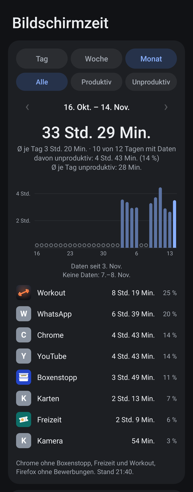
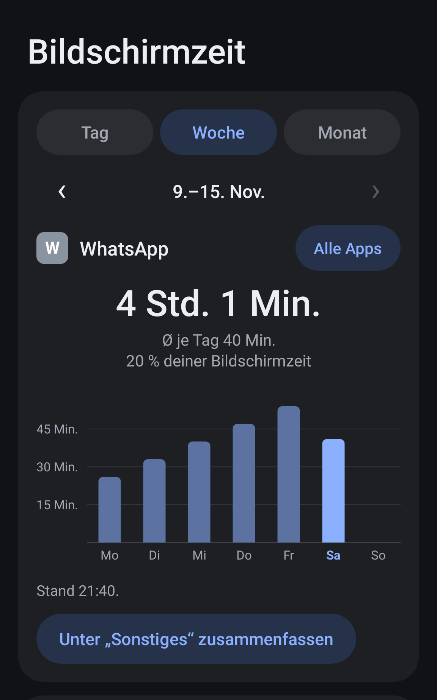
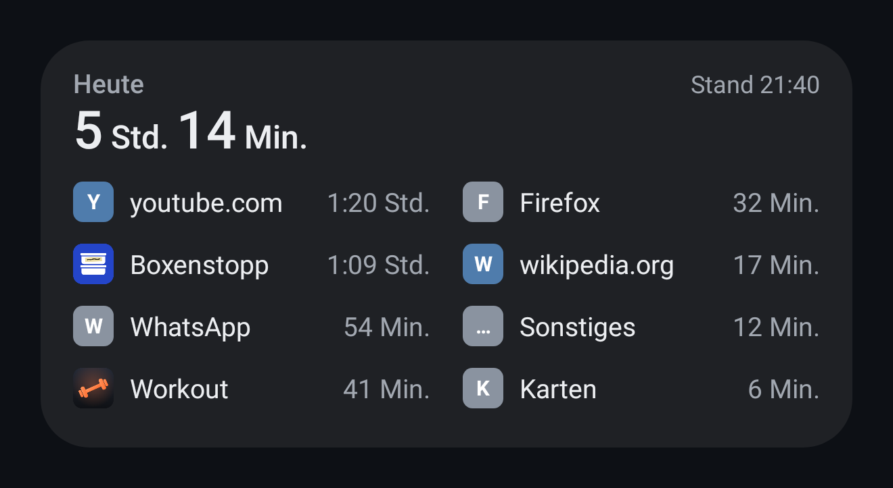

# Bildschirmzeit

> „Ich will ein eigenes Bildschirmzeit-Widget für meinen Startbildschirm
> (Samsung Galaxy S24), weil Androids Bildschirmzeit meine Web-Apps
> Boxenstopp, Freizeit und Workout nur als „Chrome“ zählt.“
>
> „Push, Daten und alles andere in den drei Apps müssen weiter funktionieren
> wie bisher.“ – Tobi

Eine kleine Android-App mit Widget: oben die Bildschirmzeit aller Apps von
heute, darunter die Top-Apps (so viele hineinpassen, bis zu 8) – und
Boxenstopp, Freizeit, Workout und die Bewerbungszentrale (im Widget
„Bewerbungen“, seit v15) stehen dort unter eigenem Namen und mit eigenem
Symbol statt als „Chrome“. Antippen öffnet die App mit der Statistik.


Weitere Vorschauen (mit erfundenen Zahlen, von `VorschauTest` und
`AppVorschauTest` gezeichnet, in den Größen von Tobis S24):
`docs/vorschau-klein-*.png` (2×2, vier Apps untereinander),
`vorschau-lang-hell.png` (3×2, lange Namen und Zeiten, ohne Netz),
`vorschau-flach-hell.png` (4×1: Kopf links, drei Apps rechts),
`vorschau-einrichten-hell.png` (ohne Erlaubnis),
`vorschau-update-hell.png` (ein Update wartet auf Tobi: oben „Update: antippen“),
`vorschau-app-hell.png` / `-dunkel.png` (der App-Bildschirm: oben die
Statistik einer Woche, darunter die Einrichtung und die Update-Karte – hell
noch nicht eingerichtet, dunkel eingerichtet), `vorschau-app-monat-*.png`
(ein Monat mit Lücken), `vorschau-app-tag-hell.png` (der Reiter Tag),
`vorschau-app-eine-hell.png` / `-dunkel.png` (eine App angetippt: ihre Woche),
`vorschau-webseiten-dunkel.png` (das Widget mit youtube.com und wikipedia.org
als eigene Einträge und „Sonstiges“, Kachel der Seiten blau),
`vorschau-app-einrichten-hell.png` (die App ohne Erlaubnis: deren Karte vor
der Statistik, mit dem Weg über die eingeschränkte Einstellung).

## Tobis Entscheidungen

- Repo öffentlich, deshalb liegt auch der Signaturschlüssel offen im Repo
  (Risiko ist erklärt, unten „Signaturschlüssel“).
- „"Andere Apps" ist ja scheiße wir brauchen diesen Kreis links nicht. Was
  ich will ist die gesamtzzeit alles Apps zu sehen und Vllt so die top 8 oder
  so mit der größten nutzungszeit. Je nachdem wieviel hin passt.“ (15.11.,
  10:40) – das Widget hat keinen Ring und kein „Andere Apps“ mehr: oben die
  Gesamtzeit, darunter bis zu acht Apps, so viele ganz hineinpassen; Antippen
  öffnet die App mit der Statistik (unten „Das Widget: Gesamtzeit und
  Top-Apps“). Gilt ab v7.
- Bis v6: Der Ring zeigte die Anteile der Apps (voller Ring = Gesamtzeit
  heute, Top 3 farbig, der Rest grau).
- „Hab ich wirklich nur diese drei Apps heute verwendet?“ (15.11., Widget mit
  Claude 16, Boxenstopp 6, Chrome 5 von 36 Min.) – in Release v5 und v6 stand der
  graue Rest als vierte Zeile „Andere Apps“ da (unter 290 dp Breite „Andere“).
  Vorher: nur die Top 3, der Rest war nur grau im Ring. Ist das Widget flacher
  als 172 dp, steht er vorn im Stand („1:09 Std. andere · Stand 21:40“); ganz
  flach (unter 125 dp) fällt der Stand samt Rest weg. Dafür sind die Abstände
  der Zeilen etwas enger (5 statt 7 dp). Geprüft bis v6 in VorschauTest
  `andereAppsAlsVierteZeile` (auch, dass der Stand nie abgeschnitten wird –
  bei 352 × 176 dp war er es im ersten Versuch). Tobis Widget meldet laut
  Screenshot etwa 400 × 201 dp. Am 15.11. um 10:40 von Tobi verworfen (oben).
- Verbunden wird aus der Widget-App (je App ein Knopf „Verbinden“); die
  Web-Apps zeigen nur „verbunden · Trennen“.
- „Wenn ich auf das widget tippe soll ich mir auch die Wochen und
  Monatsnutzung nach App aufgeteilt und so anzeigen lassen können“ (15.11.,
  10:40) – seit v7 öffnet Antippen die App, und ganz oben steht die Statistik:
  Tag, Woche, Monat, je mit allen Apps (unten „Statistik und Verlauf in der
  App“). Offen gelassen, also entschieden: Woche Montag bis Sonntag, beim
  ersten Mal der Reiter Woche, danach der zuletzt gewählte.
- „Bei Firefox bin ich viel auf Youtube. Kann man sich die größten Webseiten
  als einzelnen Punkt auflisten lassen?“ (15.11.) – seit v9 freiwillig über
  eine Bedienungshilfe (unten „Webseiten in Firefox einzeln“). Entschieden:
  nur Firefox; nur die Domain („youtube.com“, nicht die YouTube-App); eigener
  Eintrag ab einer Minute am Tag; private Tabs nie; nur auf dem Handy.
- „Das gleiche für Chrome. Aber würde sagen lass mal machen dass alles unter
  fünf min unter sonstige websiten zusammengefasst wird oder? Also Chrome und
  Firefox addiert“ (16.11.) – seit v10 auch Chrome; dieselbe Domain aus beiden
  Browsern zusammen, einzeln ab 5 Minuten (am Tag bzw. im Zeitraum), der Rest
  „Sonstige Webseiten“ (im Widget „Sonstige Seiten“, sonst abgeschnitten).
  Entschieden: Browserzeit ohne erkannte Seite (neuer Tab, privat, Dienst aus)
  bleibt „Firefox“ bzw. „Chrome“; Tobis Web-Apps zählen in Chrome weiter als
  Boxenstopp, Freizeit und Workout, nicht als Seite.
- „Eigentlich dürften Chrome und Firefox ja garnicht mehr auftauchen oder?“
  (16.11., 12:29, Widget mit Chrome als eigenem Eintrag) – seit v11 zählt Browserzeit
  ohne erkennbaren Namen (neuer Tab, Suchbegriffe statt Adresse, about:,
  privat, Inkognito) zu „Sonstige Webseiten“. „Chrome“/„Firefox“ bleibt nur
  für installierte Web-Apps (kein Web; bei Tobis Web-Apps die Zeit, die sie
  noch nicht an Supabase gemeldet haben) und für Zeit, in der die
  Bedienungshilfe nicht lief.
- „Hab nh zusätzliche App die noch nicht connected ist. Geht um die Bewerbungs
  app“ (19.11.) – seit v15 ist die Bewerbungszentrale die vierte Web-App: im
  Widget „Bewerbungen“ (wie auf dem Startbildschirm, `short_name` ihres
  Manifests) mit ihrem Symbol, Schlüssel `bewerbungszentrale`, verbunden in
  Schritt 2 wie die anderen. Bis dahin zählte sie als „Chrome“. Die Liste der
  Web-Apps steht an vier Stellen (`BZ_APPS` im Modul, Tabelle und
  `bildschirmzeit_melden` in Supabase, `WebApp` in der App);
  `tests/test-web.mjs` prüft, dass alle gleich sind (unten „Der Vertrag“).
- Diskret (17.11.): bestimmte Seiten und Apps nie mit Namen – das Widget steht
  auf dem Startbildschirm, den jeder sieht. Erotikseiten sowie Dating-Apps und
  -Seiten erkennt die App selbst, alles andere legt Tobi mit einem Tipp unter
  „Sonstiges“ (unten „Diskret“). Seit v14 heißt der Sammeleintrag „Sonstiges“
  statt „Sonstige Webseiten“: Er nimmt auch Apps auf; ein eigener Eintrag
  „Sonstige Apps“ hätte verraten, dass dort eine App steckt.
- „Ich will auch auf ne eigene App klicken und dann deren verteilung zb über
  die Woche sehen können“ (15.11., 17:21, Screenshot der Woche in v7) – ein
  Tipp auf eine App in der Statistik zeigt nur sie, je Tag (unten „Eine App
  allein“). Entschieden: Die App bleibt gewählt, wenn er Reiter oder Zeitraum
  wechselt; „Alle Apps“ oder Zurück führt zurück; am Tag nur Zeit und Anteil
  (Stunden hat der Verlauf nicht).
- „Alter stand? Keinen bock immer zu aktualisieren“ (15.11., 08:49, das
  Widget zeigte „Stand 08:43“) – gemeint war beides, und beides ist gebaut:
  Das Widget bleibt von selbst frisch, solange das Handy benutzt wird
  (unten „Von selbst frisch“), und die App installiert neue Versionen selbst
  (unten „Updates von selbst“).

## Einrichten auf dem S24

Einmal, alles am Handy:

1. In Chrome diesen Link öffnen:
   https://github.com/Finanzdienste/Bildschirmzeit/releases/latest/download/bildschirmzeit.apk
   → „Herunterladen“ (fragt Chrome „Datei trotzdem herunterladen?“, auch
   „Herunterladen“).
2. Unten „Öffnen“ antippen (oder die Mitteilung „Download abgeschlossen“).
   Beim ersten Mal kommt „Aus Sicherheitsgründen … unbekannte Apps …“ →
   „Einstellungen“ → „Diese Quelle zulassen“ für Chrome einschalten →
   zurück → „Installieren“.
3. Lässt One UI gar nicht installieren („Automatische Sperre“): Einstellungen
   → Sicherheit und Datenschutz → Automatische Sperre → aus, installieren –
   und erst nach Schritt 5 wieder einschalten (mit der Sperre an fehlt
   vermutlich „Eingeschränkte Einstellungen zulassen“, siehe unten). Ist die
   Sperre an, verhindert sie auch die Updates von selbst (Schritt 9). Dafür
   gibt es zwei Wege, und welchen, entscheidet Tobi:
   - **Sperre aus lassen** und „Unbekannte Apps installieren“ nur für
     Bildschirmzeit erlauben, für Chrome und „Eigene Dateien“ wieder entziehen
     (Einstellungen → Apps → ⋮ bzw. „Spezieller Zugriff“ → „Unbekannte Apps
     installieren“; den genauen Weg auf One UI 8 hat noch niemand geprüft).
     Dann kommen Updates still. Weniger Schutz: Die Sperre blockiert auch
     Befehle über USB, und mit dem offenen Schlüssel (unten
     „Signaturschlüssel“) nähme Android jede damit signierte APK als Update –
     ohne Sperre braucht es dafür nur noch Tobis „Installieren“ in einer App,
     die installieren darf.
   - **Sperre an, je Update kurz aus:** Widget „Update blockiert“ antippen →
     „Automatische Sperre öffnen“ → aus → zurück → „Noch einmal versuchen“
     (kommt ein Android-Fenster: „Aktualisieren“) → Sperre wieder an. Ab One
     UI 8.5 geht sie mit „Automatisch wieder einschalten“ (ganz unten auf der
     Seite der Sperre) nach 30 Minuten von selbst wieder an (Samsung-Hilfe);
     ob Tobis S24 das schon hat, ist offen.
4. Warnt Play Protect („Unsichere App blockiert“ o. Ä.): „Weitere Details“ →
   „Trotzdem installieren“. Fragt es nach einem Scan, ist beides in Ordnung.
5. „Bildschirmzeit“ öffnen. **Schritt 1** „Erlauben“ → es öffnet sich gleich
   die Seite „Zugriff auf Nutzungsdaten“ der App (auf dem S24 so gesehen) →
   Schalter ein → zurück. Ist der Schalter grau („Gesteuert durch
   eingeschränkte Einstellung“ – so bei einer APK aus Chrome):
   1. Trotzdem auf „Berechtigung erteilen“ tippen. Auf dem S24 (One UI 8) kommt
      „App wurde Zugriff verweigert … Informationen dazu, wie du den Zugriff
      erlaubst“ → „Schließen“ (auf anderen Geräten „Eingeschränkte
      Einstellung“ → „OK“). Erst danach hat die App-Info oben rechts ⋮ –
      vorher fehlt es ganz (Tobis Screenshots vom 15.11.).
   2. Die App-Info frisch öffnen: Einstellungen → Apps → Bildschirmzeit (oder
      in der App „App-Info öffnen“) → oben rechts ⋮ → „Eingeschränkte
      Einstellungen zulassen“ → mit PIN oder Fingerabdruck bestätigen.
   3. Noch einmal „Erlauben“ → Schalter ein.
   4. Fehlt ⋮ auch nach 1.: die Automatische Sperre (Schritt 3) ausschalten,
      1. und 2. wiederholen, danach die Sperre wieder ein. So der Stand am
      15.11. um 08:24 – auch nach dem Antippen kein ⋮, die Sperre war nach
      der Installation wieder an (wie Schritt 3 damals sagte).
6. **Schritt 2** – viermal: bei Boxenstopp „Verbinden“ → die Web-App öffnet
   sich in Chrome (als installierte App oder als Tab, beides teilt sich den
   Speicher) und meldet „Bildschirmzeit verbunden …“ → zurückwischen zur
   Bildschirmzeit-App. Dasselbe für Freizeit, Workout und Bewerbungen (die
   Bewerbungszentrale, seit v15). Danach steht dort
   „heute … Min., zuletzt 21:40“. Der Link geht ausdrücklich an Chrome, auch
   wenn Samsung Internet der Standardbrowser ist: Sonst landete die Kennung
   im Speicher von Samsung Internet, und die Web-Apps in Chrome blieben
   unverbunden. Nur ohne Chrome nimmt die App den Standardbrowser.
7. **Schritt 3** „Widget hinzufügen“ → „Hinzufügen“. Von Hand:
   Startbildschirm lange drücken → „Widgets“ → „Bildschirmzeit“ → antippen →
   „Hinzufügen“. Größe ändern: Widget lange drücken, an den Rändern ziehen
   (ab 2×1; 4×2 zeigt acht Apps, 2×2 vier, 4×1 drei).
8. Empfohlen, damit Samsung die App nicht schlafen legt (dann stünden
   Wecker und 15-Minuten-Lauf still): Einstellungen → Apps → Bildschirmzeit
   → Akku → „Nicht eingeschränkt“. Antippen des Widgets öffnet die App, und
   die rechnet sofort.
9. **Automatische Updates – einmal einrichten:** In der App unten
   „Automatische Updates einrichten“ → es öffnet sich „Unbekannte Apps
   installieren“ für Bildschirmzeit → Schalter („Diese Quelle zulassen“,
   bei Android selbst „Dieser Quelle vertrauen“) ein → zurück. Die Karte
   zeigt dann „Automatische Updates ✓“. Ab da installiert die App neue
   Versionen selbst (sie fragt GitHub jede Stunde; die App schließt sich
   dabei kurz, Einstellungen, Verbindungen und Widget bleiben). Will Android
   ein Update doch einmal bestätigt haben, steht dort „Neue Version
   installieren“ → antippen → „Aktualisieren“. Klappt es nicht, sagt die
   Karte warum und was zu tun ist; darunter steht klein, was Android gemeldet
   hat (für einen Screenshot an Claude). Steht im Widget oben „Update:
   antippen“, wartet ein Update auf Tobi: Widget antippen → die App öffnet
   sich mit der Update-Karte ganz oben → der Knopf auf der Karte. Steht dort
   „Update blockiert“, war es Samsungs Automatische Sperre (die zwei Wege in
   Schritt 3): Widget antippen → „Automatische Sperre öffnen“ → aus → zurück
   → „Noch einmal versuchen“. Kommt dabei Androids Fenster „Möchtest du
   diese App aktualisieren?“, obwohl es sonst still geht: Android fragt nach,
   wenn ein Versuch keine 30 Sekunden nach einem stillen kommt – dann
   „Aktualisieren“.

   **Einmal noch von Hand:** Wer eine Fassung ohne diese Karte hat (Tobi:
   1.1), installiert die nächste wie in Schritt 1–4 (Automatische Sperre
   kurz aus, Link in Chrome, „Aktualisieren“) und richtet dann Schritt 9
   ein. Danach nie wieder.

## Wie gerechnet wird

**Android** (`Nutzung.kt`, getestet in `NutzungTest`): Vordergrundzeit heute,
von lokaler Mitternacht bis jetzt, aus `UsageStatsManager.queryEvents`.

- Abgefragt wird ab 8 Stunden vor Mitternacht, damit eine App, die über
  Mitternacht offen war, ab Mitternacht zählt; gezählt wird nur [Mitternacht,
  jetzt].
- Eine App ist vorn, solange eine ihrer Activities `ACTIVITY_RESUMED` hat und
  noch kein `PAUSED`/`STOPPED`. Zwei Activities derselben App zählen einmal.
- Android nennt nur die Klasse, nicht die Instanz. Alle installierten
  Web-Apps laufen in Chrome als dieselbe Klasse (`WebappActivity`); wechselt
  man direkt von Workout zu Boxenstopp, kommt `PAUSED`(Workout),
  `RESUMED`(Boxenstopp), dann erst `STOPPED`(Workout). Ein `STOPPED` nach
  einem `PAUSED` derselben Klasse schließt deshalb nichts (es ist das späte
  Ende der pausierten Instanz); nur ein `STOPPED` ohne `PAUSED` davor
  schließt. Vorher fehlte so die ganze zweite Sitzung bei Chrome (und damit
  in der Gesamtzeit) – Test `webAppsDirektNacheinanderZaehlenGanz`. Dasselbe
  gilt für Unterseiten der Einstellungen-App.
- `SCREEN_NON_INTERACTIVE`, `KEYGUARD_SHOWN` und `DEVICE_SHUTDOWN` schließen
  alles. Nach `DEVICE_STARTUP` ohne vorheriges Ausschalten (Akku leer) zählt
  das Offene nicht – wie lange es lief, weiß niemand.
- Nicht gezählt: jede HOME-Activity (Startbildschirm, Übersicht, auch der
  Notfall-Startbildschirm der Einstellungen), `com.android.systemui` und Pakete
  ohne Eintrag im App-Drawer. Die Bildschirmzeit-App selbst zählt mit. Sichtbar
  sind die Pakete über `<queries>` (MAIN/LAUNCHER, MAIN/HOME), nicht über
  `QUERIES_ALL_PACKAGES`.
- Installierte Web-Apps (Pakete `org.chromium.webapk.*`) sind nur ein
  Startknopf für Chrome; ihre Sekunden zählen zu Chrome.

**Chrome kürzen** (`Aufteilung.kt`, `AufteilungTest`): Die Widget-App liest
mit `bildschirmzeit_lesen` die letzten acht Tage (einmal nach dem ersten
Nachtragen des Verlaufs weiter zurück, unten „Statistik und Verlauf“) und
nimmt für heute, was jede Web-App gemeldet hat. Das wird von Chrome
abgezogen und als „Boxenstopp“, „Freizeit“, „Workout“ gezeigt. Haben die
drei zusammen mehr gemeldet, als Chrome lief, werden sie anteilig auf
Chromes Zeit gekürzt (Rest nach größtem Bruchteil) – die Gesamtzeit ist also immer die von Android. Was von Chrome
übrig bleibt, steht als „Chrome“ da.

**Ohne Netz:** Es gilt, was zuletzt von Supabase kam (SharedPreferences), und
das Widget schreibt leise „Stand 21:40 · ohne Netz“ (nur wenn mindestens eine
Web-App verbunden ist). Das steht da, solange der letzte Netzversuch
schiefging – auch bei den Rechnungen dazwischen, die Supabase gar nicht fragen
(`Speicher.netzFehlt`).

**Wann** (`Takt.kt`, `Aktualisierung.kt`; Begründung unten „Von selbst
frisch“): ein nicht weckender Wecker alle 2 Minuten, solange das Handy
benutzt wird, und gleich nach dem Einschalten des Bildschirms; dazu
WorkManager alle 15 Minuten (unique, KEEP; nach einem Neustart plant
WorkManager selbst neu, den Wecker plant `Hintergrund` nach Neustart und
Update neu). Supabase höchstens alle 5 Minuten, bei dunklem Bildschirm
höchstens stündlich, sonst gilt der Zwischenspeicher. `updatePeriodMillis`
ist 0: Androids eigener 30-Minuten-Takt weckte das Handy auch nachts und
rechnete und funkte doppelt. Antippen öffnet die App; die rechnet beim
Öffnen sofort mit Netz und zeichnet das Widget mit (`Aktualisierung.fuerApp`).
Kommt ein Widget neu auf den Startbildschirm, rechnet es gleich im Empfänger
(`goAsync`, eigener Faden): erst ohne Netz zeichnen, dann mit. Eine Sperre
verhindert zwei Rechnungen zugleich; „Alle Daten löschen“ läuft unter
derselben Sperre.

**Warum Samsungs Zahl um Minuten abweichen kann:** Samsungs Digital Wellbeing
rechnet selbst und anders (eigene Zusammenfassung der Nutzungsdaten, zählt
z. B. Telefonate oder Apps ohne Symbol im App-Drawer, die hier fehlen, und
lässt dafür anderes weg; geteilter Bildschirm und Bild-im-Bild werden anders
gewertet). Das Widget zeigt den Stand seiner letzten Rechnung (während
der Benutzung höchstens gut 3 Minuten alt, Antippen öffnet die App und holt
nach). Die
Web-Apps messen nur, solange sie sichtbar sind, und melden alle 5 Minuten
und beim Wegschalten – was seit der letzten Meldung dazukam, steht bis
dahin noch bei Chrome.

## Das Widget: Gesamtzeit und Top-Apps (v7)

> „"Andere Apps" ist ja scheiße wir brauchen diesen Kreis links nicht. Was
> ich will ist die gesamtzzeit alles Apps zu sehen und Vllt so die top 8
> oder so mit der größten nutzungszeit. Je nachdem wieviel hin passt. Wenn
> ich auf das widget tippe soll ich mir auch die Wochen und Monatsnutzung
> nach App aufgeteilt und so anzeigen lassen können“ – Tobi, 15.11., 10:40
> (Screenshot: links der Ring mit der Gesamtzeit, rechts drei Apps, darunter
> „Andere Apps …“ und „Stand 10:40“).

**Vorher (bis v6):** Links der Ring mit der Gesamtzeit, rechts
„Bildschirmzeit“, die Top 3 mit Farbpunkt (der Legende des Rings) und „Andere
Apps“ als vierte Zeile; 2×2 zeigte nur den Ring. Antippen schickte einen
Broadcast ans Widget, das neu rechnete; nur beim Update-Hinweis öffnete es
die App.

**Jetzt** (`WidgetAnsicht.kt`; „Je nachdem“ hieß: wir entscheiden):

- Oben klein „Heute“ (wartet ein Update: „Update: antippen“ in der
  Akzentfarbe), rechts daneben „Stand 10:40“, darunter groß die Gesamtzeit
  aller Apps (in den Bildern erfunden „4 Std. 7 Min.“ – dieselbe Summe wie
  vorher in der Ringmitte).
- Darunter die Top-Apps nach Zeit mit Symbol, Name und Zeit – so viele, wie
  ganz hineinpassen, höchstens 8; nie eine halbe Zeile. Kein Ring, keine
  Farbpunkte (die waren nur seine Legende), kein „Andere Apps“, auch nicht im
  Stand.
- Zwei Spalten, wenn beide breit genug sind: links Platz 1–4, rechts 5–8.
- Lange Namen werden mit „…“ gekürzt, die Zeit nie. Ganz ohne Nutzung
  „0 Min.“ und „Heute noch nichts“.
- Hell und dunkel wie bisher aus `values-night`.

**Wie viele passen** (`WidgetRaster`, rein, in dp): Rand 16 dp seitlich, 14
oben und unten, dazu 4 dp Reserve, falls Samsungs Schrift höher läuft als
Roboto. Kopf 47 dp („Heute“ 16, Gesamtzeit 31), Zeile 20 dp (Symbol 20,
Text 13 sp), kompakt 18 dp (12 sp), Abstand 6–12 dp, 10 dp unter dem Kopf.
Zwei Spalten nur, wenn jede mindestens 168 dp (kompakt 140) breit ist – so
viel brauchen Symbol, „Boxenstopp“ und „1:09 Std.“ mit etwas Luft. Unter
262 dp Innenbreite steht der Stand unter der Gesamtzeit (sonst passten
„Update: antippen“ und „Stand 21:40 · ohne Netz“ nicht nebeneinander). In
flachen Widgets steht der Kopf links (140 dp) und die Liste rechts. Es gewinnt
die Möglichkeit mit den meisten Apps; bei Gleichstand die größere Schrift,
dann der Kopf oben, dann eine Spalte (ein hohes 4×3 zeigt die acht
untereinander, statt unten leer zu bleiben). Androids Schriftgröße zählt mit:
größere Schrift, weniger Zeilen, nichts abgeschnitten. Flacher als jede Zelle
fällt erst der Stand weg, dann „Heute“; die Gesamtzeit bleibt.

**Der Kopf in der Breite** (`WidgetAnsicht.Kopf`, nach der Prüfung des
Umbaus): Die Texte werden in der Schrift des Widgets gemessen (mit Androids
Schriftgröße, auch der nichtlinearen ab Android 14, und einem Zwanzigstel
Luft). Passt „Stand 21:40 · ohne Netz“ nicht, fällt erst „· ohne Netz“ weg,
dann „Stand“; „Update: antippen“ wird „Update“ (erst ab etwa 200 %); die
Gesamtzeit wird kleiner (26 sp abwärts, höchstens bis 12 sp) statt
abgeschnitten. Vorher stand bei 130 % Schrift in einem 2×2 auf engem Raster
(170 dp) „18 Std. 49“ ohne „Min.“ und „Stand 21:40 · ohne“ da, bei 110 dp
Breite schon bei 100 % „4 Std. 7“. Wo alles passt, bleibt es, wie es war;
die Bilder sind byte-gleich. In Tobis 400 × 201 steht auch bei 130 % alles
ganz da („Update: antippen“, „Stand 21:40 · ohne Netz“, die Gesamtzeit in
26 sp). Im 2×2 mit 200 × 201 fällt bei 130 % „· ohne Netz“ weg: Der Stand
ist dort gut 161 dp breit, mit der Luft 169, Platz sind 168 dp; bei 100 und
110 % bleibt es. Die Luft bleibt trotzdem: Läuft die Schrift auf dem S24 nur
etwas breiter, stünde ohne sie wieder „Stand 21:40 · ohne“ da (eine Zeile,
Android bricht am Wort ab) – lieber ganz ohne den Zusatz als halb.

| Größe (dp) | Was das Widget zeigt |
|---|---|
| 400 × 201 (Tobis 4×2) | acht Apps in zwei Spalten |
| 352 × 176 (4×2 auf einem 4×5-Raster) | sechs in zwei Spalten, kompakt |
| 300 × 176, 264 × 176 (3×2) | drei |
| 400 × 100 (4×1) | Kopf links, drei Apps rechts |
| 200 × 201 (2×2 bei Tobi) | vier untereinander, kompakt |
| 170 × 170 (2×2, enges Raster) | drei, „Boxenstopp“ gekürzt |
| 352 × 290, 400 × 300 (4×3) | acht untereinander |
| 170 × 290 (2×3) | acht untereinander, kompakt |
| 170 × 100 (2×1) | nur der Kopf |

`widget_info.xml`: Standard 4×2, verkleinerbar jetzt bis 2×1
(`minResizeHeight` 40 statt 110 dp) – auch 4×1 zeigt Apps.

**Antippen öffnet die App** (`WidgetAnsicht.oeffnen`): `MainActivity` mit dem
Extra `ziel` (`Ziel.kt`, der Vertrag mit der App): `statistik`, beim
Update-Hinweis `update` (auch ohne Erlaubnis: `statistik`, die App zeigt dann
Schritt 1). Je Ziel ein eigener requestCode – sonst wäre es für Android
derselbe PendingIntent, und das zuletzt gesetzte Ziel gälte für beide.
`FLAG_IMMUTABLE`, dazu `NEW_TASK | CLEAR_TOP | SINGLE_TOP`: Läuft die App
schon (auch mit Androids Einstellungen darüber), bekommt sie das neue Ziel
über `onNewIntent`. Ausnahme, solange eine Installation läuft
(`UpdateSpeicher.sitzung`): Androids Rückfrage „Möchtest du diese App
aktualisieren?“ liegt dann im Task der App über ihr, und `CLEAR_TOP` räumte
sie ohne Antwort weg – die Sitzung hinge bis zu 10 Minuten
(`UpdateRegeln.SITZUNG_MS`), nachgelesen in AOSP (PackageInstallerActivity
meldet nur in `finish()`). Dann nur `NEW_TASK`, und Android holt den Task so
nach vorn, wie er ist, samt Rückfrage. Damit das auch klappt, wenn die App
vom Symbol gestartet wurde, ist die Absicht dieselbe wie die des Symbols
(`MAIN`/`LAUNCHER` an MainActivity, nur mit dem Extra); eigene requestCodes
(12, 13), weil `FLAG_UPDATE_CURRENT` nur Extras ersetzt, keine Flags. Der
Selbstupdate-Ablauf selbst ist unverändert; v6 → v7 läuft noch mit dem Code
von v6. Die App zeigt dann ganz oben die Statistik (den zuletzt
gewählten Reiter mit dem jetzigen Zeitraum, beim ersten Mal die Woche) bzw.
die Update-Karte direkt unter dem Titel – unten „Statistik und Verlauf in der
App“. Sie rechnet beim Öffnen sofort mit Netz und zeichnet
das Widget neu, so bringt Antippen weiter frische Zahlen. Den Broadcast
`AKTUALISIEREN` gibt es nicht mehr; `Anlass.TIPPEN` bleibt nur für ein Widget,
das neu auf den Startbildschirm kommt (`onUpdate`).

**Geprüft:** `WidgetRasterTest` (die Größen oben; über alle Größen von
110 × 40 bis 800 × 460 dp bei 100, 115 und 130 % Schrift: höchstens 8, nie
mehr Zeilen, als ganz passen, keine zu wenig, zwei Spalten nur, wenn breit
genug; größer zeigt nie weniger), `VorschauTest` (an den echten Views über die
gemessene Lage, nicht measuredHeight: jede Zeile, Stand und Gesamtzeit ganz im
Widget, nichts gekürzt außer Namen; Tobis 400 × 201 mit acht Apps und
„Boxenstopp“, „WhatsApp“, „LinkedIn“, „Instagram“, „1:09 Std.“, „54 Min.“ ganz;
kein Ring, kein „Andere“; drei Apps, keine; 130 % Schrift; der Hinweis;
`widget_info`; `kopfBeiGroesserSchriftGanz`: elf Größen bis 110 × 40 dp bei
100, 110 und 130 % mit „18 Std. 49 Min.“, ohne Netz und mit Hinweis; im
200 × 201 bei 130 % „Stand 21:40“, bei 100 und 110 % mit „· ohne Netz“),
`WidgetTippenTest` (Antippen startet genau MainActivity mit dem
Ziel, in jeder Form; je Ziel ein eigener PendingIntent; eine neue Zeichnung
über die alte; während einer Installation ohne `CLEAR_TOP`, mit der Absicht
des App-Symbols), `SelbstupdateTest` (über den Wecker gezeichnet: Update →
`update`, danach `statistik`), `WidgetOeffnetAppTest` (beide Teile zusammen:
genau die Absicht, die das Antippen startet, öffnet MainActivity – Statistik
oben, Woche, ganz oben gescrollt, die App rechnet und zeichnet das Widget;
auch, wenn die App schon offen war; mit Hinweis die Update-Karte auf dem
ersten Bildschirm). Mutationen (Kopf zu niedrig geschätzt, Spalten
zu schmal, derselbe requestCode) machen je mindestens einen Test rot. Ein
Gegenprobe-Test nur mit Schnittstellen beider Fassungen war gegen ff04888
(v6) 7-mal rot (acht Apps, kein „Andere Apps“, „Heute“, kein Ring, Antippen →
Statistik, Update → Update, 2×1 erlaubt) und ist jetzt grün.

**Zeigt sich erst auf dem S24:** welche Größen One UI für 4×1, 2×2 und 4×3
meldet (hier aus Tobis 400 × 201 abgeleitet) und ob Samsungs Schrift mit den
4 dp Reserve auskommt.

## Von selbst frisch (Release nach v5)

> „Alter stand? Keinen bock immer zu aktualisieren“ – Tobi, 15.11., 08:49
> (Screenshot: „Stand 08:43“).

**Vorher:** Gerechnet wurde nur alle 15 Minuten (WorkManager, das Minimum)
und beim Antippen. Ein Stand von 6 Minuten war normal, bis zu 15 möglich.

**Jetzt:** Ein Wecker (AlarmManager, `setInexactRepeating`, Art
`ELAPSED_REALTIME` – **nicht** `_WAKEUP`) klingelt alle 2 Minuten. Er weckt
das Handy nie, braucht keine Erlaubnis für genaue Wecker und keinen Dienst
im Vordergrund. Der WorkManager-Lauf alle 15 Minuten bleibt (für
Mitternacht, wenn das Handy liegt, und für die Update-Prüfung).

**Warum das reicht – nachgelesen in AOSP (Android 16,
`AlarmManagerService`):** Ist der Bildschirm aus, hält Android nicht
weckende Wecker zurück (`checkAllowNonWakeupDelayLocked`) und stellt sie in
dem Moment zu, in dem der Bildschirm angeht (`interactiveStateChangedLocked`).
Schaut Tobi nach einer Pause aufs Handy, rechnet das Widget also sofort;
benutzt er es durchgehend, ist der Stand höchstens gut 3 Minuten alt
(ungenaue Wecker legt Android bis 75 % des Abstands zusammen: 2 bis 3½
Minuten). Eine App mit Widget auf dem Startbildschirm steht in Androids
Standby-Gruppe „aktiv“ (`AppStandbyController`, `isBoundWidgetPackage`) –
ohne Begrenzung der Wecker. Ein Update der App überleben Wecker, einen
Neustart nicht: `Hintergrund` (nicht exportiert) plant nach
`BOOT_COMPLETED` und `MY_PACKAGE_REPLACED` neu. Ohne Widget gibt es keinen
Wecker.

**Drosselung (`Takt.plan`):** Rechnen ist billig (Androids Ereignisse seit
Mitternacht, Millisekunden) – der Wecker rechnet bei jedem Klingeln, nur
nicht, wenn die letzte Rechnung keine Minute her ist. Teuer ist das Netz:
Supabase höchstens alle 5 Minuten (öfter melden die Web-Apps auch nicht),
bei dunklem Bildschirm gar nicht aus dem Wecker und aus WorkManager
höchstens stündlich; dazwischen gilt der Zwischenspeicher. „· ohne Netz“
richtet sich nach dem letzten Netzversuch: Hat Supabase geantwortet, fehlt
es (die Zahlen sind höchstens ein paar Minuten alt), ging er schief, bleibt
es bei jeder Rechnung stehen, bis Supabase wieder antwortet. Im ersten
Versuch fiel es zwischen zwei Versuchen weg, obwohl die Zahlen der Web-Apps
Stunden alt sein konnten (Prüfer, 15.11.; in v5 fragte jeder Lauf Supabase).
Das Öffnen der App (auch über das Widget) fragt immer.

**Was es kostet, ehrlich:** Akku: Der Wecker läuft nur, wenn das Handy
ohnehin wach ist – bei angeschaltetem Bildschirm höchstens 30-mal in der
Stunde je ein paar Dutzend Millisekunden Rechnen und Zeichnen, neben dem
Bildschirm nicht messbar; bei dunklem Bildschirm hängt er sich nur an, wenn
etwas anderes das Handy weckt (dann ohne Netz). Daten: eine
Supabase-Abfrage sind einige KB (mit TLS-Aufbau grob 5–10 KB). Höchstens
12 in der Stunde, während das Handy benutzt wird, sonst höchstens eine –
bei 4 Stunden Bildschirmzeit am Tag rund 70 Abfragen, grob 0,5 MB am Tag.
Vorher waren es 96 am Tag (alle 15 Minuten, auch nachts).

**Geprüft:** `TaktTest` (die Regeln), `WeckerTest` (nicht weckend,
ungenau, 2 Minuten, Supabase nach 5 Minuten, im Dunkeln ohne Netz, neu
eingeplant nach Neustart und Update, ohne Widget kein Wecker, Empfänger
nicht exportiert; `ohneNetzBleibtZwischenDenNetzversuchenStehen`: offline
steht „· ohne Netz“ bei jeder Wecker-Zeichnung, auch ohne Netzversuch – in
der ersten Fassung fehlte es dort). Gegen f02bb03 (v5) bauten die neuen
Tests nicht (die Klassen fehlten); ein Test nur mit Schnittstellen, die beide Fassungen
haben, war dort 3-mal rot (kein Wecker, kein Empfänger für Neustart und
Update, keine Rechte zum Installieren) und ist jetzt grün.

## Updates von selbst (Release nach v5)

> „Keinen bock immer zu aktualisieren“ – Tobi, 15.11.

**Vorher:** Die App fragte GitHub beim Öffnen; „Neue Version verfügbar“ →
„Herunterladen“ öffnete den Link im Browser, installiert wurde von Hand (und
oft erst nach dem Ausschalten der Automatischen Sperre).

**Jetzt** (`Selbstupdate.kt`, Regeln in `UpdateRegeln`): Der
WorkManager-Lauf (alle 15 Minuten) fragt GitHub höchstens jede Stunde
(`releases/latest`, ohne Token 60 Anfragen je Stunde und Adresse – im
Mobilfunk teilen sich viele eine Adresse; trifft es die Grenze, klappt es in
der nächsten Stunde), das Öffnen der App höchstens alle 10 Minuten. Bis v15
fragte der Hintergrund nur alle 4 Stunden – Tobi, 19.11.: „Jo app
aktualisiert sich ja nur alle vier Stunden“. Hat das Öffnen die neue Fassung
schon gefunden, installiert sie der nächste Lauf, sobald die App zu ist (die
Karte: „Sie kommt bald von selbst, wenn die App zu ist – oder jetzt.“), der
Knopf „Neue Version installieren“ sofort. Ist das
Release neuer und Schritt 9 eingerichtet, lädt die App die APK, prüft sie
und installiert sie über eine `PackageInstaller`-Sitzung – ohne Rückfrage.
Nicht, solange die App offen ist (die Installation schließt sie), nicht
während einer laufenden Installation (Sitzung gemerkt, 10 Minuten nach
`commit` verworfen – war Androids Rückfrage gezeigt, 10 Minuten danach, und
dann sagt die Karte „Android-Fenster zu lange offen – noch einmal
versuchen“; bis v7 zählte die Frist ab dem Start des Laufs, vor dem Laden,
und verwarf still), nicht unter Android 12 (dort fragte Android jedes Mal;
dann nur der Knopf). Die Karte unten in der App zeigt den Stand; ihr Knopf ist der
einzige Weg von Hand („Automatische Updates einrichten“, „Neue Version
installieren“, „Noch einmal versuchen“; „Im Browser herunterladen“ nur,
wenn GitHub keine Prüfsumme nennt).

**Warum ohne Rückfrage – nachgelesen in AOSP (Android 16,
`PackageInstallerSession.computeUserActionRequirement`):** Android verlangt
keine Bestätigung, wenn die Sitzung `USER_ACTION_NOT_REQUIRED` setzt (ab
Android 12), die App `UPDATE_PACKAGES_WITHOUT_USER_ACTION` deklariert, die
neue APK targetSdk ≥ 33 hat (hier 36) und die App **sich selbst**
aktualisiert (`isSelfUpdate` – dafür muss sie nicht Installer of Record
sein) – und „Unbekannte Apps installieren“ für sie erlaubt ist (sonst
`isInstallDisabledForPackage` → Rückfrage). Schritt 9 ist genau diese
Erlaubnis (`REQUEST_INSTALL_PACKAGES`, `canRequestPackageInstalls()`;
sie gehört nicht zu den „eingeschränkten Einstellungen“). Ausnahme: Hat
ein anderer Installer die Update-Hoheit (Update-Owner), fragt Android
einmal nach (`REASON_REMIND_OWNERSHIP`). Diese Rückfrage zeigt die App nur
im Vordergrund – nach Tobis Tippen auf „Neue Version installieren“ und nur
Androids eigene `CONFIRM_INSTALL`-Absicht, ohne weitergereichte
Dateirechte; kommt sie im Hintergrund, wird die Sitzung verworfen und die
Karte sagt „Android will dieses Update einmal bestätigt haben“. Verwirft die
App eine Sitzung selbst (diese Rückfrage, eine über 10 Minuten alte, Reste),
schickt Android dazu noch „abgebrochen“ (`abandon` →
`dispatchSessionFinished(INSTALL_FAILED_ABORTED)`). Deshalb merkt sich die
App die Sitzung gleich nach `createSession` (vor `commit`, Androids Antwort
kann vorher kommen), vergisst sie vor dem Verwerfen und nimmt außer einem
Erfolg nur Meldungen zur gemerkten Sitzung an. Im ersten Versuch
überschrieb dieses „abgebrochen“ den wahren Grund, die Karte sagte
„Abgebrochen“, und der Fehlversuch zählte doppelt (Prüfer, 15.11.).
`setRequestUpdateOwnership` setzt die App nicht: Laut AOSP wirkt es nur bei
der Erstinstallation („on package update is a no-op“), und ein
Selbst-Update braucht keine Update-Hoheit.

**Sicher:** Geladen wird nur über HTTPS und nur
`https://github.com/Finanzdienste/Bildschirmzeit/releases/download/v<n>/bildschirmzeit.apk`
(höchstens 50 MB) in den eigenen Speicher (`noBackupFilesDir/update`).
Der SHA-256 muss mit dem Feld `digest` der GitHub-API übereinstimmen, die
Größe mit `size`; Paketname und versionCode der Datei
(`getPackageArchiveInfo`) müssen unsere und genau die Laufnummer des
Release sein, nie gleich alt oder älter. Die Signatur prüft Android (gleiche
Signatur wie die installierte App) – nichts davon wird umgangen. Der
Status-Empfänger `UpdateStatus` ist nicht exportiert, der PendingIntent
explizit und `FLAG_MUTABLE` (nur so kann Android Status und Rückfrage
eintragen; ab targetSdk 35 Pflicht). Im Log stehen Statuscodes und Androids
Meldung, gesäubert wie auf der Karte (ohne Pfade) – die Kennung hat mit dem
Update nichts zu tun.

**Fehlschläge:** Kein Netz, falsche Prüfsumme, keine Erlaubnis, Androids
Status (abgebrochen, blockiert, Konflikt, inkompatibel, beschädigt,
Speicher, Zeitüberschreitung) – die Karte nennt den Grund und den nächsten
Schritt als Klickfolge. „Abgebrochen“ (`STATUS_FAILURE_ABORTED`) heißt nicht
nur, dass Tobi abgebrochen hat; die App liest deshalb (seit dem nächsten
Release) auch Androids Meldung (`EXTRA_STATUS_MESSAGE`), den Legacy-Code
(`android.content.pm.extra.LEGACY_STATUS`) und ein anderes Paket
(`EXTRA_OTHER_PACKAGE_NAME`) und teilt danach auf (`UpdateRegeln.fehlerAus`):

| Androids Meldung | Fehler (Code im Speicher) | Die Karte sagt |
|---|---|---|
| „… unknown source package“ (Samsung: „Self update is blocked …“ ohne Fenster, „User rejected installing …“ nach dem Fenster „Unbekannte App gesperrt“) | `SPERRE` (`sperre`) | „Update blockiert“: Samsungs Automatische Sperre → Knopf „Automatische Sperre öffnen“ → aus → zurück → „Noch einmal versuchen“ (Android-Fenster: „Aktualisieren“), danach kann sie wieder an |
| Legacy -22/-21 oder „INSTALL_FAILED_VERIFICATION…“ | `PRUEFUNG` (`pruefung`) | ein Paket-Prüfer, meist Play Protect; noch einmal, sonst Screenshot an Claude |
| „User rejected permissions“ | `ABGEBROCHEN` (`abgebrochen`) | Androids Fenster ging ohne „Aktualisieren“ zu |
| „Session was abandoned“ | `VERWORFEN` (`verworfen`) | Android hat verworfen; die App versucht es von selbst noch einmal |
| keine Meldung | `ABGEBROCHEN` | beide Wege: Fenster geschlossen → noch einmal + „Aktualisieren“; kein Fenster oder „Unbekannte App gesperrt“ → Sperre kurz aus |

„Blockiert“ (`STATUS_FAILURE_BLOCKED`) gibt es bei Installationen in AOSP
nur für `INSTALL_FAILED_PRE_APPROVAL_NOT_AVAILABLE`; die Sperre kommt nie so.
Bis v7 sagte die Karte dort „meist Samsungs Automatische Sperre“ – das war
falsch, jetzt nennt sie den Status und bittet um einen Screenshot. Die
Meldung wird gesäubert (`UpdateRegeln.meldungSaeubern`: `file:…`,
`content://…`, `/data/…` und andere Pfade werden „…“, eine Zeile, höchstens
120 Zeichen) und mit dem Fehler gemerkt, dazu, ob der Versuch vom Knopf oder
aus dem Hintergrund kam und ob Androids Rückfrage gezeigt wurde. Unter dem
Text steht sie klein, etwa „Android: INSTALL_FAILED_ABORTED: Self update is
blocked by unknown source package · 15:12 · Hintergrund · ohne Rückfrage“;
dieselbe Zeile steht im Log. Der Hintergrund wartet nach dem n-ten
Fehlschlag 1, 2, 4, 8, 16, dann 24 Stunden; bei falscher Datei, Konflikt,
inkompatibel und nach Samsungs Sperre gar nicht mehr bis zum nächsten
Release (bei der Sperre käme sonst ihr Fenster „Unbekannte App gesperrt“
ungefragt, oder sie verwürfe still Stunde um Stunde). Der Knopf wartet nie.
Ein neues Release setzt alles zurück.

**Wenn es Tobi braucht, sagt es das Widget:** Benachrichtigungen hat die App
nicht, und wer sie nicht öffnet, sieht die Karte nie. Kommt ein neueres
Release ohne Tobi nicht an, steht im Widget oben „Update: antippen“ statt
„Heute“ (in der Akzentfarbe), und Antippen öffnet die App mit `Ziel.UPDATE`
(die App rechnet dabei auch neu); ganz oben, direkt unter dem Titel, wartet
die Karte mit Grund und Knopf. Das gilt, wenn Schritt 9 fehlt,
GitHub keine Prüfsumme nennt, Android bestätigt haben will, bei
abgebrochen, blockiert, Samsungs Sperre, einem Paket-Prüfer, einem zu lange
offenen Android-Fenster, falscher Datei, Konflikt, inkompatibel – und nach
drei Fehlschlägen hintereinander, auch wenn Warten sonst hilft
(`UpdateRegeln.widgetHinweis`). War es Samsungs Sperre, steht dort „Update
blockiert“ statt „Update: antippen“ (`UpdateRegeln.widgetGesperrt`; bei
sehr großer Schrift wie der andere Hinweis „Update“). Nach jedem Status
von Android und gleich nach dem Start einer Sitzung (vor `commit`) zeichnet
die App die Widgets ohne Netz neu (`Aktualisierung.neuZeichnen`): So steht
der Hinweis sofort da, und ein vorher gezeichnetes Widget öffnet die App
während der Installation nicht mehr mit `CLEAR_TOP` (das hätte eine offene
Rückfrage weggeräumt; die Flags stehen beim Zeichnen fest, bis v7 bis zum
nächsten Wecker). Nicht, solange installiert wird
oder der Hintergrund es noch von selbst schafft. Der Hinweis steht in jeder
Größe des Startbildschirms (auch 2×1 und 4×1); nur flacher als jede Zelle
fällt „Heute“ samt Hinweis weg, Antippen öffnet dann trotzdem die
Update-Karte. Bis v6 gab es ihn unter 150 dp Höhe und im 2×2 nicht. Was es kostet: beim
Zeichnen ein Blick in den eigenen Speicher, nichts übers Netz. Vorher stand
das nur auf der Karte (Prüfer, 15.11.).

**Was es kostet:** höchstens 24 Anfragen an GitHub am Tag aus dem
Hintergrund (je rund 4 KB, also unter 100 KB), dazu beim Öffnen der App; die APK (rund
0,75 MB) einmal je Release.

**Geprüft:** `UpdateRegelnTest` (Prüfsumme, Fassung, Wartezeit, Status →
Text, die Karte, wann das Widget Bescheid sagt), `SelbstupdateTest` (der
ganze Weg auf einem nachgebauten Gerät: installiert ohne Rückfrage, falsche Prüfsumme →
nichts, ohne Erlaubnis kein Download, nie gleich alt oder älter, GitHub
höchstens jede Stunde, kein zweites Update während eines laufenden,
Wartezeit nach Fehlern, Rückfrage im Hintergrund verworfen und im
Vordergrund nur nach dem Knopf gezeigt, Androids „abgebrochen“ nach dem
eigenen Verwerfen zählt nicht, Tobis „Abbrechen“ im Dialog schon, Karte →
Einstellungen → Installieren, das Widget sagt „Update: antippen“ und öffnet
die App bei der Update-Karte), `UpdateSperreTest` (Androids Meldung auf der
Karte und im Log, ohne Pfad; „abgebrochen“ nach Meldung aufgeteilt; ohne
Meldung beide Wege, „blockiert“ ohne Sperre; nach der Sperre kein
Hintergrund-Versuch, der Knopf darf, ein neues Release setzt zurück; das
Widget gleich nach dem Start ohne `CLEAR_TOP` und nach dem Status „Update
blockiert“; der Knopf öffnet Samsungs Seite, sonst Sicherheit, sonst
Einstellungen; die Frist ab `commit` und ab der Rückfrage – nur mit
Schnittstellen, die es bis v7 gab, und gegen v7 jeder rot), `VorschauTest`
(`updateHinweisImKopf`: ganz, auch bei 2×2 und 4×1, „Update blockiert“
ebenso; `kopfBeiGroesserSchriftGanz` bis 130 % und bei 200 %),
`WidgetTippenTest` (Antippen → `Ziel.UPDATE`),
`DatenTest` (die Antwort von GitHub, nur Adressen dieses
Repos), `WeckerTest` (Rechte im Manifest). Mutationen (Prüfsumme weg,
Rückfrage auch ohne Knopf, Wartezeit weg, zweite Sitzung erlaubt, Wecker
weckend) machen je mindestens einen Test rot. Nie das echte GitHub
(`Netz.gesperrt`, Abruf und Download in den Tests ersetzt).

**Zeigt sich erst auf dem S24 – und was der erste Versuch gezeigt hat:**
Das erste Selbst-Update, v6 → v7 am 15.11., endete mit der Karte „Update hat
nicht geklappt – Version 1.7: Abgebrochen – nichts installiert …“ (Tobis
Screenshot; inzwischen ist v7 drauf). Androids Meldung dazu ist verloren,
denn v6 und v7 lesen nur den Status (3, ABORTED). Wahrscheinlich war es
Samsungs Automatische Sperre: Nach dekompiliertem Samsung-Code (aus fremden
One-UI-7-Builds, nicht der Firmware des S24) verwirft sie ein Selbst-Update
einer App, die weder aus Play Store noch Galaxy Store kommt, mit -115 und
„Self update is blocked by unknown source package“ (oder nach ihrem Fenster
„Unbekannte App gesperrt“ mit „User rejected installing unknown source
package“) – öffentlich ist das ABORTED, also „Abgebrochen“. „Unbekannte Apps
installieren“ bleibt dabei erlaubt (die Karte zeigte keinen Einrichten-Knopf),
denn die Sperre prüft über einen eigenen Schalter. Samsungs Hilfe sagt
dasselbe: „Die Automatische Sperre kann die Aktualisierung von Apps
blockieren, wenn die dafür benötigte Installationsdatei aus einer nicht
autorisierten Quelle stammt.“ Belegt ist es für dieses Handy nicht: Ob die
Sperre in dem Moment an war, weiß niemand, und ein ohne „Aktualisieren“
geschlossenes Android-Fenster oder Play Protect ergäben dieselbe Karte. Das
trennt erst die Meldung, die die App seit dem nächsten Release mitschreibt –
also beim Update danach: v7 → nächstes Release läuft noch mit dem alten Code
(dieselbe Karte, kein Knopf zur Sperre). Ist die Sperre an, für dieses eine
Update von Hand: Einstellungen → Sicherheit und Datenschutz → Automatische
Sperre → aus → Bildschirmzeit öffnen → „Noch einmal versuchen“ (oder „Neue
Version installieren“; kommt ein Android-Fenster: „Aktualisieren“) → die
Sperre danach nach Wunsch wieder an.
**Bestätigt (15.11., Tobi):** „Ja es lag an der Sperre. Wenn ich die
ausschalte klappts.“ – mit eingeschalteter Automatischer Sperre kommt kein
Update an, mit ausgeschalteter geht es. Die Wahl zwischen „Sperre aus lassen“
und „je Update kurz aus“ (Schritt 3) bleibt Tobis.
Weiter offen: ob One UI 8 bei ausgeschalteter Sperre wirklich ohne Rückfrage
durchlässt (AOSP sagt ja), ob die mit „Eigene Dateien“ installierte Fassung
einen Update-Owner hat (dann kommt die Rückfrage über den Knopf), ob die
Sperre ihr Fenster zeigt oder still verwirft, ob die Aktion
`com.samsung.android.rampart.action.MAIN_SETTING_ACTIVITY` auf dem S24 die
Seite der Sperre öffnet (sonst landet der Knopf in „Sicherheit und
Datenschutz“, sonst in den Einstellungen), ob Play Protect warnt, und wie
genau der Schalter heißt.

## Statistik und Verlauf in der App (v7)

> „Wenn ich auf das widget tippe soll ich mir auch die Wochen und
> Monatsnutzung nach App aufgeteilt und so anzeigen lassen können“ – Tobi,
> 15.11., 10:40 (Screenshot seines Widgets).



**Vorher:** Die App zeigte oben den Ring von heute und weiter unten „Heute“
mit den Apps von heute. Woche und Monat gab es nicht – Android hebt seine
Ereignisse ohnehin nur rund zehn Tage auf (unten). Antippen des Widgets
rechnete nur neu.

**Jetzt** (`Statistik.kt`, `Balken.kt`, `MainActivity.kt`): Antippen öffnet
die App mit einem Ziel (`Ziel.kt`, Extra `ziel`): `statistik`, mit
Update-Hinweis `update`. Ganz oben steht die Statistik, darunter die
Einrichtung (Nutzungsdaten, Web-Apps, Widget, Update-Karte, Löschen). Fehlt
die Erlaubnis, steht deren Karte vor der Statistik (ohne sie gibt es keine
Zahlen); kommt die App wegen eines Updates, steht die Update-Karte oben. Die
App rechnet beim Öffnen wie bisher sofort mit Netz und zeichnet die Widgets
neu – Antippen bringt also weiter frische Zahlen.

- Reiter Tag | Woche | Monat, je mit ‹ › – nicht über heute hinaus und nicht
  vor den Beginn des Verlaufs. Woche Montag bis Sonntag („9.–15. Nov.“, über
  den Monatswechsel „26. Okt. – 1. Nov.“, übers Jahr „28. Dez. – 3. Jan.
  2027“ – die Jahreszahl einmal, hinten; mit beiden passte der Titel bei
  größerer Schrift nicht zwischen ‹ und ›, und passt er trotzdem nicht, wird
  er kleiner statt umbrochen), Monat der Kalendermonat („November 2026“), Tag
  „Heute“, „Gestern“, „Sa., 14. Nov.“. Gemerkt wird der zuletzt von Hand
  gewählte Reiter; das Widget öffnet ihn mit dem jetzigen Zeitraum, beim
  ersten Mal „Woche“.
- Drehen und der Wechsel hell/dunkel nach Zeitplan bauen die Activity neu:
  Der Zeitraum, den Tobi gerade ansieht, bleibt (`onSaveInstanceState`); das
  Ziel des Widgets gilt nur für ein neues Antippen. Zurück aus einem Tag, den
  ein Tipp auf einen Balken geöffnet hat, führt in die Woche bzw. den Monat
  davor, statt die App zu schließen – über `OnBackInvokedCallback`, angemeldet
  nur, solange so ein Tag offen ist. Das Manifest setzt seit der ersten
  Fassung `enableOnBackInvokedCallback="true"`: Ab Android 13 kommt Zurück
  deshalb nur über solche Rückrufe an, `onBackPressed` gar nicht (Lint
  `GestureBackNavigation`) – auf 13 bis 15 genauso wie auf Tobis Android 16.
  Darunter (Android 10 bis 12) gibt es den Rückruf nicht; dort schließt
  Zurück die App wie bisher, auch aus dem Tag vom Balken.
- Je Zeitraum die Gesamtzeit, bei Woche und Monat „Ø je Tag“ nur über die
  Tage mit Daten (fehlen welche: „· 5 von 7 Tagen mit Daten“), dazu Balken der
  Tagessummen: eigene View mit Canvas, keine Bibliothek, Farben aus dem Thema
  (hell und dunkel), heute im vollen Akzent, höchstens drei leise Linien mit
  runden Stunden. Ein Tipp auf einen Balken zeigt diesen Tag im Reiter Tag.
- Darunter alle Apps des Zeitraums nach Zeit, mit Symbol, Zeit und Anteil in
  %. Die Web-Apps (Boxenstopp, Freizeit, Workout, Bewerbungen) stehen unter
  eigenem Namen, Chrome nur mit dem Rest; „Stand 21:40“, solange der Zeitraum heute enthält.
- Tage ohne Daten: im Diagramm ein kleiner leerer Kreis statt eines Balkens,
  darunter „Keine Daten: 7.–8. Nov.“, im Reiter Tag „keine Daten“ – nie 0.
  Beginnt der Verlauf erst im Zeitraum: „Daten seit 3. Nov.“. Ein Tag mit
  Daten, aber ganz ohne Nutzung, heißt „0 Min.“ wie im Widget (vorher „unter
  1 Min.“ über „Heute noch nichts.“) und hat im Diagramm einen flachen Strich
  – sonst sähe er aus wie ein Tag, der erst kommt.

**Warum ein eigener Verlauf – nachgelesen in AOSP (main,
`UsageStatsDatabase.prune`):** Bei jedem Tageswechsel
(`UserUsageStatsService.rolloverStats`) löscht Android die Tagesdateien, die
älter als 10 Tage sind („prune all files older than 10 days“,
`mCal.addDays(-10)`; dazu höchstens 100 Dateien,
`MAX_FILES_PER_INTERVAL_TYPE`). `queryEvents` liest nur diese Tagesdateien
(`queryStats(INTERVAL_DAILY, …)`); Wochen-, Monats- und Jahresdateien halten
nur Summen je App, nach Androids eigener Zählung und nicht je Tag – dafür
taugen sie nicht. Samsung kann länger aufheben. Deshalb führt die App einen
eigenen Tagesverlauf, nur auf dem Handy.

**Der Verlauf** (`Verlauf.kt`): je Kalendertag eine kleine Datei
(`noBackupFilesDir/verlauf/2026-11-15.json`, rund 1 KB): Sekunden je App nach
dem Abzug der Web-Apps von Chrome, mit Namen (so bleiben auch deinstallierte
Apps lesbar), die gemeldeten Web-Minuten und ob Androids Teil fertig ist.
Aufbewahrt 400 Tage. `noBackupFilesDir` geht nie in die Android-Sicherung;
`datenregeln.xml` schließt dazu sicherheitshalber Dateien und Datenbanken aus.
Geschrieben wird über eine Zwischendatei und nur bei Änderungen. Gefüllt:

1. **Heute** bei jeder Rechnung (Wecker, WorkManager, neues Widget, App –
   auch über das Widget) – mit dem, was ohnehin gerechnet ist.
2. **Vergangene Tage** nur, wenn sie fehlen (`stand.json`: bis wann
   nachgetragen ist): nach Mitternacht einmal der Vortag ganz (Androids
   Ereignisse ab 8 Stunden vor seiner Mitternacht bis zur nächsten), am
   ersten Start rückwirkend bis zu 62 Tage, so weit Android Ereignisse hat.
   Ein Tag zählt nur, wenn Android ihn ganz hat – Ereignisse schon vor seiner
   Mitternacht, oder Android hat den Vortag im selben Lauf hergegeben, oder
   der Tag bzw. der Vortag steht im Verlauf und ist höchstens 9 Tage alt
   (`Verlauf.ANDROID_SICHER_TAGE`: älter kann Android ihn inzwischen
   weggeräumt haben – etwa wenn zehn Tage nichts gerechnet hat). Die älteste
   Tagesdatei beginnt mitten am Tag; dieser Tag bliebe sonst zu kurz und steht
   deshalb als „keine Daten“ da – oder, steht er schon im Verlauf, wie er ist.
3. **Nie weniger** (`Rechner.nieWeniger`, nach der Prüfung des Umbaus): Was
   ein Tag im Verlauf schon hat, geht nicht verloren – je App zählt das
   Größere aus dem Verlauf und aus Androids neuer Rechnung, heute wie beim
   Nachtragen. Eine App, die Tobi deinstalliert, kennt Android danach nicht
   mehr (AOSP `UsageStatsDatabase.onPackageRemoved` nimmt ihr Token weg,
   `IntervalStats.deobfuscateEvents` wirft ihre Ereignisse beim Lesen weg);
   vorher fiel ihre Zeit spätestens beim nächsten Wecker aus dem Tag, und
   nach Mitternacht stand er so als fertig da. Jetzt bleibt sie, mit dem
   Namen, unter dem sie stand. Sonst wächst ein Tag ohnehin nur.
4. **Nachtragen wiederholt:** Vorgerückt wird nur bis zum letzten Tag, den
   Android ganz hergab – nach jedem Tag gespeichert, so geht ein
   abgebrochener erster Lauf dort weiter. Gab Android die letzten Tage nicht
   her (eine leere Antwort, etwa kurz nach einem Neustart, bevor Android den
   Nutzer geladen hat, oder das Handy war aus), versucht es die Rechnung
   höchstens einmal je Stunde noch einmal (`Rechner.NOCHMAL_MS`); vorher blieb
   der Vortag dann für immer beim Stand vor Mitternacht. Älter als 10 Tage
   wird nichts neu versucht.
5. **Die Web-Apps:** Die gewöhnliche Abfrage liest weiter heute − 7 … heute;
   die vergangenen Tage darin werden bei jedem Netz aufgefrischt (die
   Web-Apps melden auch verspätet, `p_tage` mit mehreren Tagen) – kein Byte
   mehr übers Netz, geschrieben nur bei Änderung. Ältere Tage gelten als
   fertig – außer ihre Web-Werte wurden noch vor dem Ende des Tages gelesen
   (die App hatte danach über eine Woche kein Netz, die Web-Apps meldeten
   weiter): Dann holt die nächste Netzabfrage sie einmal mit (vorher blieb
   der Abend dann für immer in Chrome). Fehlen nach dem Nachtragen Web-Werte
   älterer Tage, liest die nächste Abfrage einmal weiter zurück: dieselbe eine Anfrage
   `bildschirmzeit_lesen(p_kennung, p_von, p_bis)`, höchstens die 62 Tage,
   die Supabase hält (was älter ist, sucht sie danach nicht weiter – sonst
   läse nach langer Zeit ohne Netz jede Abfrage 62 Tage). Je Tag wird wie heute aufgeteilt (`aufteilen`), die
   Summe bleibt die von Android. „verbunden“ heißt weiter: in den letzten
   acht Tagen gemeldet. Das SQL bleibt, wie es ist.
6. **Tagesgrenzen** über `ZoneId`: Der 29.3. hat 23 Stunden, der 25.10. 25;
   wechselt die Zeitzone, gilt der Kalendertag auf dem Handy.

**Was es kostet:** Der Wecker liest weiter nur heute (eine Abfrage ab 8
Stunden vor Mitternacht), dazu `stand.json` und die Datei von heute (je
wenige hundert Byte) und schreibt höchstens die Datei von heute. Nach
Mitternacht einmal der Vortag; gab Android ihn nicht her, höchstens stündlich
noch einmal. Nur der erste Start
nach dem Update liest bis zu 62 Tage, einmal (Android hat meist zehn).
Supabase wie bisher höchstens alle 5 Minuten acht Tage, einmal weiter zurück.
Platz: 400 Tage zu je 1–2 KB, unter 1 MB.

**„Alle Daten löschen“** löscht jetzt auch den Verlauf; die Statistik beginnt
mit heute neu – nicht gleich wieder rückwirkend aus Androids Ereignissen,
sonst stünde nach dem Löschen alles wieder da. Ohne Netz ist nichts gelöscht,
auch der Verlauf nicht (`Rechner.allesLoeschen`, unter derselben Sperre).

**Geprüft:** `StatistikTest` (Woche Mo–So, über Monats- und Jahreswechsel,
Sommerzeitwochen, Monat, Titel, ‹ › und die Grenze heute, Summen und Ø nur
über Tage mit Daten, „keine Daten“ nie 0, ein Tag ohne Nutzung „0 Min.“,
„Daten seit“, Anteile),
`VerlaufTest` (speichern, laden, kaputte Datei, verspätete Web-Meldungen neu
aufgeteilt, nur Änderungen geschrieben, nichts sucht ewig nach Tagen, die
Supabase nicht mehr hat, 400 Tage, löschen, Tagesgrenzen am
29.3. und 25.10. in Europe/Berlin und zum Jahreswechsel, angeschnittene Tage,
nicht in der Sicherung), `VerlaufRechnerTest` (nachgebautes Gerät: erster
Start rückwirkend ohne den angeschnittenen ältesten Tag, eine Supabase-Anfrage
für den Bereich, **der Wecker liest nur heute** und nach Mitternacht einmal
den Vortag, dabei Supabase weiter acht Tage, verspätete Meldungen, ohne Netz
später nachgetragen, deinstallierte App bleibt im Tag, auch wenn Android ihre
Ereignisse vergisst und der Wecker gleich danach rechnet, ein nach zehn Tagen
angeschnittener Tag ersetzt nicht den bekannten und wird nicht aus dem
bekannten Vortag erfunden, eine leere Antwort nach Mitternacht wird nach
einer Stunde wiederholt, vor Tagesende gelesene Web-Werte werden nach neun
Tagen ohne Netz noch geholt, Löschen; diese fünf Fälle waren gegen den Stand
vor der ersten Nachbesserung rot), `AppStatistikTest` (Statistik
oben, Woche beim ersten Mal, gemerkter Reiter, ‹ ›, Tipp auf einen Balken →
Tag, Tag ohne Daten, ohne Erlaubnis deren Karte zuerst, Ziel `update` →
Update-Karte oben, der Löschen-Dialog nennt den Verlauf, neu gebaut bleibt
der Zeitraum, Zurück aus dem Tag vom Balken über den Rückruf wie auf
dem S24; `TitelBreiteTest`: „28. Dez. – 3. Jan. 2027“ bei 360 dp und 100,
110, 130 % ganz in einer Zeile), `AppVorschauTest`
(die Bilder), `WidgetOeffnetAppTest` (vom Antippen des Widgets bis zur
Statistik bzw. Update-Karte; gegen `verlauf-statistik` allein 2-mal rot: das
alte Widget mit „Bildschirmzeit“ statt „Heute“, beim Update ohne Ziel). Gegen ff04888 bauen die neuen Tests nicht (die Klassen fehlen);
ein Test nur mit Schnittstellen beider Fassungen war dort 4-mal rot (kein
Reiter „Woche“, Update-Karte nicht oben, kein Verlauf, Dateien in der
Sicherung) und ist jetzt grün.

**Zeigt sich erst auf dem S24:** wie lange One UI die Ereignisse wirklich
aufhebt (AOSP: zehn Tage – „Daten seit“ sagt es nach dem ersten Start), wie
die Statistik in Tobis Hand aussieht.

## Eine App allein (nächstes Release)

> „Ich will auch auf ne eigene App klicken und dann deren verteilung zb über
> die Woche sehen können“ – Tobi, 15.11., 17:21 (Screenshot: die Woche in v7).



**Vorher (v7):** Die Liste unter den Balken zeigte alle Apps des Zeitraums;
antippen ließ sich nur ein Balken (der Tag).

**Jetzt** (`Statistik.kt`, `MainActivity.kt`): Jede Zeile der Liste lässt
sich antippen. Dann zeigt die Statistik nur diese App:

- Oben ihr Symbol und Name, rechts „Alle Apps“. Die große Zahl ist ihre Zeit
  im Zeitraum, darunter „Ø je Tag …“ (über die Tage mit Daten, auch die, an
  denen sie nicht lief) und „27 % deiner Bildschirmzeit“.
- Die Balken sind ihre Tage: ein Tag mit Daten, an dem sie nicht lief, ist
  der flache Strich (0), ein Tag ohne Daten bleibt der leere Kreis. Damit
  auch eine App mit wenigen Minuten Linien bekommt, kennt die Achse jetzt
  auch 5 und 10 Minuten (`Balken.stufe`).
- Die Liste ist weg, solange eine App gewählt ist (die Balken sind ihre
  Verteilung). Reiter, ‹ › und ein Tipp auf einen Balken behalten die App –
  so blättert Tobi durch ihre Wochen und Monate. Am Tag stehen nur Zeit und
  Anteil: Der Verlauf kennt Tage, keine Stunden.
- Zurück: aus dem Tag vom Balken in den Zeitraum, dann zu allen Apps, dann
  schließt die App wie gewohnt (derselbe `OnBackInvokedCallback`, angemeldet,
  solange ein Tag vom Balken oder eine App offen ist). „Alle Apps“ führt die
  Liste dorthin zurück, wo sie war. Drehen behält die App; ein neues Antippen
  des Widgets zeigt wieder alle.
- Gerechnet wird aus demselben Verlauf (`auswerten(…, nur = Schlüssel)`):
  keine neue Datei, kein Netz.

**Geprüft:** `StatistikTest.eineAppUeberDieWoche` und
`eineAppOhneZeitUndAmTag` (Werte je Tag, 0 gegen „keine Daten“, Ø, Anteil,
ohne Auswahl wie bisher); `AppStatistikTest.appAntippenZeigtIhreVerteilung`
(Tipp auf die Zeile, Kopf, Zeit, Balken für TalkBack, Monat und Woche zurück,
„Alle Apps“), `zurueckVonDerAppZuAllen`, `appUeberstehtDrehenAberNichtDasWidget`;
Bilder `vorschau-app-eine-hell.png` / `-dunkel.png`.

## Webseiten in Firefox und Chrome einzeln (v9, v10)

> „Bei Firefox bin ich viel auf Youtube. Kann man sich die größten Webseiten
> als einzelnen Punkt auflisten lassen?“ – Tobi, 15.11.

> „Das gleiche für Chrome. Aber würde sagen lass mal machen dass alles unter
> fünf min unter sonstige websiten zusammengefasst wird oder? Also Chrome und
> Firefox addiert“ – Tobi, 16.11. (nach dem ersten Abend mit v9: „Zuletzt
> erkannt: …“ mit einer Seite, die Firefox-Zeit von vorher noch ganz „Firefox“).

**v10 – Chrome, zusammen, ab 5 Minuten:**
- Der Dienst sieht auch Chrome (`com.android.chrome`, `com.chrome.beta`,
  `…dev`, `…canary`). Chromes Adresszeile, nachgelesen in Chromium
  (chromium.googlesource.com): `…:id/url_bar` (ein EditText auch ohne Tippen –
  getippt wird nur mit Fokus), auf dem neuen Tab `…:id/search_box_text`
  (`fake_search_box_layout.xml`, keine Seite), Inkognito am Abzeichen
  `…:id/location_bar_incognito_badge` („Inkognitomodus“,
  `location_status.xml`) – dann keine Domain.
- Installierte Web-Apps (WebappActivity, WebApk…), Trusted Web Activities
  und Custom Tabs ohne Leiste sind „keine Seite“ (nicht „das Bisherige“):
  Der Dienst merkt sich die Activity des letzten Fensterwechsels. Tobis
  Web-Apps auf `finanzdienste.github.io` zählen in Chrome nie als Seite – sie
  kommen über Supabase unter eigenem Namen (in Firefox zählen sie als Seite,
  dort sind sie nicht verbunden).
- Im Verlauf steht jede erkannte Seite je Browser als Posten (`seite:<paket>/<domain>`,
  auch unter einer Minute), die Browser behalten nur ihre Zeit ohne erkannte
  Seite. Gezeigt wird zusammengefasst (`webseitenZusammenfassen`, in der
  Statistik `auswerten`): dieselbe Domain aus beiden Browsern addiert
  (`webseite:<domain>`), einzeln ab 5 Minuten im Tag (Widget) bzw. im
  Zeitraum (Tag, Woche, Monat), der Rest als „Sonstiges“ (blaue Kachel „…“;
  bis v13 „Sonstige Webseiten“, im Widget „Sonstige Seiten“ – die volle
  Fassung war in Tobis 4×2 abgeschnitten). Eine angetippte Seite zählt in
  jeder Woche einzeln, „Sonstiges“ lässt sich auch antippen. Die Gesamtzeit
  ändert sich nie.



**Vorher:** Android kennt nur Apps. Was in Firefox offen war, stand als eine
Zeile „Firefox“ da.

**Warum eine Bedienungshilfe:** Welche Seite offen ist, weiß Android nicht
(UsageEvents nennen nur Paket und Activity), und Firefox gibt es keiner
anderen App. Sichtbar ist es nur in Firefox' Adresszeile – lesen darf die
nur eine Bedienungshilfe (`AccessibilityService`), so machen es auch andere
Bildschirmzeit-Apps.

**Jetzt** (`Webseiten.kt`, `WebseitenDienst.kt`, Karte 4 der App):

- Der Dienst „Bildschirmzeit: Webseiten“ bekommt nur Ereignisse von Firefox
  (`packageNames` in `xml/webseiten_dienst.xml`: `org.mozilla.firefox`,
  `…firefox_beta`, `…fenix`), nur Fenster- und Inhaltswechsel, und handelt
  nie (keine Gesten, keine Tasten, kein Text). Er liest den Baum nur bis zur
  Adresszeile, höchstens 600 Knoten, nie den Inhalt der Seite (GeckoView).
- **Die Adresszeile**, nachgelesen in Firefox' Quellen (searchfox,
  mozilla-central): Die neue Leiste (Compose) setzt `testTagsAsResourceId`,
  ihr Feld heißt `ADDRESSBAR_URL_BOX` und trägt nur die Beschreibung
  „‹Titel› ‹Adresse›. ‹Hinweis›“ (`Origin.kt`, `getContentDescription`); die
  alte Leiste ist ein TextView `…:id/mozac_browser_toolbar_url_view`. Beim
  Tippen (Eingabe, Fokus) zählt nichts. Steht nur der Hinweis da (neuer Tab)
  oder `about:…`, ist es „keine Seite“.
- **Private Tabs** erkennt der Dienst am Tab-Zähler („Offene private Tabs:
  2. …“ bzw. „Private Tabs Open: 2. …“, tabcounter `strings.xml`) – dann
  merkt er keine Domain, die Zeit bleibt „Firefox“.
- **Gespeichert** wird nur bei einem Wechsel eine Zeile „Uhrzeit, Paket,
  Domain“ in `noBackupFilesDir/webseiten/beobachtungen.txt` – nie Pfad,
  Abfrage, Titel oder Inhalt, nie im Log, nie in der Sicherung, nie im Netz
  (nicht nach Supabase). Nach 12 Tagen fällt sie weg; „Alle Daten löschen“
  löscht sie mit. Geht der Dienst an oder aus, steht eine Zeile „alle, keine“.
- **Domain:** die registrierbare (`domainAus`): „m.youtube.com/watch?v=…“ →
  „youtube.com“, „www.bbc.co.uk“ → „bbc.co.uk“ (eine kleine Liste
  zweistufiger Endungen), „finanzdienste.github.io“ bleibt ganz.
- **Gedrosselt:** nach einem Fensterwechsel nach 0,3 s, auf
  Inhaltsereignisse (ein Video schickt sie ständig) höchstens alle 5 s, auf
  einem eigenen Faden (`Drossel`).
- **Rechnung:** Firefox' Vordergrund-Stücke kommen aus genau derselben
  Rechnung wie jede App-Zeit (`vordergrundZeiten` meldet sie); jedes Stück
  zählt für die zuletzt davor gesehene Domain (`seitenZeiten`, höchstens 12
  Stunden alt – ein Vollbild-Video ohne Leiste zählt weiter für youtube.com).
  Eine Domain mit mindestens 1 Minute am Tag wird ein eigener Posten
  `seite:<paket>/<domain>` (angezeigt als die Domain, blaue Kachel ohne
  Favicon), Firefox wird um sie gekürzt (`seitenAbziehen`, nie mehr, als
  Firefox lief); der Rest bleibt „Firefox“. **Die Gesamtzeit ändert sich
  nie.** Im Verlauf faltet `Tag.androidTeil` die Seiten wieder in Firefox,
  so zählt `nieWeniger` nichts doppelt, und neue Web-App-Werte (`mitWeb`)
  lassen die Seiten stehen.
- **Karte 4 „Webseiten einzeln (freiwillig)“:** aus – was es tut, ehrlich mit
  Androids Warnung, Knopf „Einschalten“ (öffnet die Eingabehilfe) und die
  Klickfolge; an – „Läuft. Zuletzt erkannt: youtube.com, 16:40.“ oder „Noch
  keine Webseite erkannt – Firefox einmal öffnen“; eingeschaltet, aber nicht
  gebunden – aus- und wieder einschalten.

**Einschalten auf dem S24 (One UI 8):** In Bildschirmzeit Karte 4 →
„Einschalten“ → „Installierte Apps“ → „Bildschirmzeit: Webseiten“ → Schalter
ein → „Zulassen“. Ist der Schalter grau („eingeschränkte Einstellung“): wie
bei Schritt 1 in der App-Info ⋮ → „Eingeschränkte Einstellungen zulassen“
(laut AOSP gilt die Freigabe von Schritt 1 für alle eingeschränkten
Einstellungen der App).

**v11 – Browser nur noch, wo kein Web ist:** Der Dienst merkt sich drei
Arten: eine Domain; `?` („eine Seite ohne erkennbaren Namen“: neuer Tab,
Suchbegriffe, about:, privat, Inkognito – zählt zu „Sonstige Webseiten“, nie
einzeln, auch über 5 Minuten); „kein Web“ (installierte Web-App, Custom Tab
ohne Leiste, Tobis Web-Apps in Chrome – bleibt beim Browser). Vorher galten
`?` und „kein Web“ beide als „keine Seite“ und blieben beim Browser. Karte 4
nennt je Browser die zuletzt erkannte Seite („youtube.com in Firefox, 12:20;
in Chrome noch keine Seite“), damit man sieht, ob beide gelesen werden.
Beobachtungen von vor v11 bleiben, wie sie waren (ihr „keine Seite“ lässt sich
nicht nachträglich trennen).
Geprüft: `WebseitenTest.wasDerDienstSichMerkt` (die drei Arten, `?` nie
einzeln), `WebseitenGeraetTest.chromeUndFirefoxZusammenKleineUnterSonstige`
(Suche → Sonstige, Web-App → Chrome, Summe gleich),
`karteVierAusAnUndWasZuletztKam` (je Browser, `?` zählt nicht als erkannt).

**v12 – woher die Browserzeit kommt:** Tobi, 16.11., 21:07 (Widget mit
v10: „Update blockiert“, Chrome ganz oben): „Zwei Stunden Chrome?“ Die
Web-Apps hatten an dem Tag kaum Zeit gemeldet, daran lag es also nicht. Damit das nicht geraten werden muss, teilt dieselbe Rechnung
(`stuecke`, gemeinsam mit `seitenZeiten`) jede Browserzeit von heute auf
(`browserZeiten`): Seiten mit Namen, ohne Namen, Web-Apps (kein Web), nicht
erfasst (die Bedienungshilfe lief nicht oder hat den Browser nie erkannt).
`Rechner` merkt sie bei jeder Rechnung in `webseiten/heute.json` (nur
Sekunden je Browser, keine Seiten; „Alle Daten löschen“ nimmt sie mit), Karte
4 zeigt sie: „Chrome heute 2 Std. 4 Min.: 1 Std. 30 Min. Seiten, 10 Min.
ohne Namen, 24 Min. nicht erfasst.“ Geprüft: `WebseitenTest.browserZeitAufgeschluesselt`,
`WebseitenGeraetTest.chromeUndFirefoxZusammenKleineUnterSonstige` (die Aufteilung
nach einer echten Rechnung).

**Geprüft (v10):** `WebseitenTest.chromeLeiste` (url_bar mit und ohne Fokus,
Suchbegriffe, neuer Tab, Inkognito, Web-App, Custom Tab, Vollbild),
`webAppsInChromeKeineSeite`, `zusammenfassenBeideBrowserAbFuenfMinuten`
(addiert, genau 5 Minuten, Sonstige, Summe gleich),
`statistikFasstJeZeitraumZusammen` (Woche einzeln, Tag „Sonstige“, angetippt
in jedem Zeitraum); `WebseitenGeraetTest.chromeUndFirefoxZusammenKleineUnterSonstige`
(Rechnung mit Androids Ereignissen: youtube.com 50 Min. aus beiden Browsern,
Chrome nach der Web-App, „Sonstige Webseiten“, Summe 100 Min., im Verlauf je
Browser); `VorschauTest.sonstigeSeitenGanzImWidget`. Nebenbei:
`AppStatistikTest.appUeberstehtDrehenAberNichtDasWidget` hing am echten Datum
(nach dem Drehen galt die echte Uhr, ab 16.11. eine Woche ohne erfundene
Daten) – jetzt mit fester Uhr.

**Geprüft:** `WebseitenTest` (Domain: Host, ganze Adresse, Zugangsdaten und
Port, zweistufige Endungen, Suchtext und about: → keine; die neue Leiste mit
und ohne Titel, nur Hinweis; die alte Leiste, beim Tippen nichts; keine Leiste
→ das Bisherige; private Tabs deutsch und englisch, „nicht privat“ nicht;
zwei Leisten; die Aufteilung mit Lücke, Weitergelten, zu alt, Dienst an/aus,
anderer Browser; das Kürzen mit 1-Minuten-Grenze, anteilig, ohne Firefox;
der Verlauf: Falten, `mitWeb`, `nieWeniger` ohne Doppelzählung, ein Tag von
vor der Funktion; die Drossel) und `WebseitenGeraetTest` (der Dienst im
Manifest nur für Firefox und nur lesend; der Schalter aus
`ENABLED_ACCESSIBILITY_SERVICES`; die Beobachtungen nur bei einem Wechsel,
ohne Pfad, nach 12 Tagen weg, gelöscht; die Rechnung mit Androids Ereignissen:
40 und 20 Minuten Seiten, Firefox ganz weg, die Summe bleibt, auch bei der
nächsten Rechnung und ohne Dienst; „Alle Daten löschen“; Karte 4 aus, nicht
gebunden, läuft mit und ohne Erkanntes); Bild
`vorschau-webseiten-dunkel.png`.

**Zeigt sich erst auf dem S24:** welche Leiste Tobis Firefox gerade hat und
ob ihre Beschreibung so aussieht wie in den Quellen (sonst bleibt alles
„Firefox“ und Karte 4 sagt „noch keine Webseite erkannt“ – dann bitte einen
Screenshot); ob One UI den Dienst in Ruhe lässt (Akku); ob Firefox mit
eingeschalteter Bedienungshilfe spürbar langsamer wird.

## Diskret: manche Seiten und Apps nie mit Namen (v13, v14)

**Warum:** Das Widget steht auf dem Startbildschirm, den jeder sieht – manche
Seiten sollen dort (und in der Statistik) nie mit Namen erscheinen. Auf
Tobis Wunsch vom 17.11.

**Jetzt** (`Diskret.kt`):
- **Erotik** erkennt Erotikseiten am Namen, ohne Netz und ohne Liste aus dem
  Netz: Wörter im Namen („porn“, „xxx“, „hentai“ und die großen Seiten),
  Endungen nur für Erwachsene (.xxx, .porn, .adult, .sex, .sexy), eine kleine
  Liste bekannter Seiten ohne solches Wort, und „sex“ nur am Anfang eines
  Teils (so nicht sussex.ac.uk, essex.gov.uk). Ändert sich die Erkennung,
  `DISKRET_STAND` erhöhen.
- **Verborgen**: Jede andere Seite oder App legt Tobi in der Statistik selbst
  dazu – antippen → unten in der Karte „Unter „Sonstiges“ zusammenfassen“ →
  Rückfrage. Die Liste liegt in `noBackupFilesDir/webseiten/verborgen.txt`
  (nie in der Sicherung, nie im Netz). Die Karte „Diskret“ sagt, wie viele es
  sind, „Wieder einzeln zeigen“ leert die Liste (gilt nur für die Zukunft).
  „Alle Daten löschen“ leert sie auch.
- Solche Seiten zählen immer zu „Sonstiges“: Der Dienst merkt sich
  für sie nur „eine Seite ohne Namen“ (`zuMerken(…, verborgen)` → `?`), die
  Anzeige legt sie unter „Sonstiges“ (`einzelneDomains(…, verborgen)`), und was
  schon mit Namen gespeichert war, wird umgeschrieben (`namenEntfernen`:
  jeder Tag im Verlauf und die Beobachtungen; die Zeiten bleiben, `androidTeil`
  ist gleich, also zählt `nieWeniger` nichts doppelt). Für die Erkennung
  passiert das einmal beim ersten Lauf nach dem Update (`Speicher.erotikStand`),
  für eine selbst zusammengelegte Seite sofort (unter `Aktualisierung.allein`).

**v14 – Dating, mehr Seiten, „Sonstiges“** (Tobi, 17.11.: Dating-Apps
sollen auch dorthin; eine Erotikseite war nicht erkannt):
- **Partnersuche** erkennt Dating-Apps am Paket (`com.tinder` …), am Namen
  der App (genau: „Tinder“, „Lovoo“, „Parship“ …) oder an Wörtern („dating“,
  „partnersuche“, „singleb“, „flirt“), Dating-Seiten an der Domain. Apps
  zählen nur in der Anzeige zu „Sonstiges“ (Widget, Statistik); im Verlauf
  bleiben sie mit Paket – Android kennt sie ohnehin, und `nieWeniger`
  braucht die Pakete.
- Die Liste bekannter Erotikseiten ist größer und steht nur als Prüfsumme im
  Code (die ersten 16 Zeichen von SHA-256 der Domain, `Erotik.pruefsumme`) –
  das öffentliche Repo trägt keine Seitennamen. `DISKRET_STAND` = 2: Die
  nächste Rechnung schreibt Gespeichertes neu erkannter Seiten einmal um.
- Jede App lässt sich selbst zusammenlegen (Statistik → App antippen →
  unten in der Karte „Unter „Sonstiges“ zusammenfassen“; in der Liste als
  `app:<paket>`). Der Knopf stand in v13 groß oben unter dem Namen, jetzt
  leise am Ende der Karte. Die
  Hinweise und „Wieder einzeln zeigen“ stehen jetzt in einer eigenen Karte
  „Diskret“ (nicht mehr in Karte 4, sie gilt auch ohne Bedienungshilfe).
- Der Sammeleintrag heißt überall „Sonstiges“ (Widget wie App).
Geprüft: `DiskretTest.datingAppsUndSeiten`, `appsUnterSonstiges`,
`bekannteSeitenNurAlsPruefsumme`; `DiskretGeraetTest.datingAppNurAlsSonstiges`,
`eineAppSelbstZusammenfassen`.

**Geprüft:** `DiskretTest` (Erkennung mit Fehltreffer-Proben, der Dienst
merkt keinen Namen, Anzeige und Statistik nur „Sonstiges“, ein Tag ohne
Namen mit gleicher Zeit) und `DiskretGeraetTest` (nach dem Update ohne Namen
in Widget, Verlauf und Beobachtungen; eine Seite selbst zusammenfassen mit
Rückfrage, Karte „Diskret“, „Wieder einzeln zeigen“; „Alle Daten löschen“).

## Der Vertrag zwischen Widget-App, Supabase und Web-Apps

**Supabase** – Projekt `vjyohppohmvhhxgwouti` („Finanzdienste's Project“),
Quelle `supabase/bildschirmzeit.sql` (live als Migration „bildschirmzeit“),
geprüft von `tests/test-sql.mjs` (PGlite). URL
`https://vjyohppohmvhhxgwouti.supabase.co`, öffentlicher Schlüssel
`sb_publishable_wTUNShIKMFjCOmZzQuuN-A_vFHPkKUI` – nur als Kopf `apikey`,
kein `Authorization` (es ist kein JWT).

| Funktion (`POST /rest/v1/rpc/…`) | Wer | Eingabe | Antwort |
|---|---|---|---|
| `bildschirmzeit_anmelden` | Widget-App | `p_kennung` | `true` |
| `bildschirmzeit_melden` | Web-Apps | `p_kennung`, `p_app` (`boxenstopp`/`freizeit`/`workout`/`bewerbungszentrale`), `p_tage` `{"JJJJ-MM-TT": sekunden}` | `true`; `false` = Kennung nicht (mehr) angemeldet |
| `bildschirmzeit_lesen` | Widget-App | `p_kennung`, `p_von`, `p_bis` (≤ 62 Tage) | `[{app, tag, sekunden, aktualisiert}]` |
| `bildschirmzeit_loeschen` | Widget-App | `p_kennung` | `true`/`false`; danach meldet `melden` `false` |

Je Tag gilt der größere Wert (Tagesstand, kein Zuwachs). Tage außerhalb
heute − 8 … heute + 1 (UTC) fallen still weg, mehr als 10 Tage auf einmal
sind ein Fehler. Gespeichert wird nur der SHA-256 der Kennung.

**Kennung:** 32 zufällige Byte (SecureRandom) als base64url ohne „=“, 43
Zeichen (`^[A-Za-z0-9_-]{32,128}$`), einmal von der Widget-App erzeugt und in
ihren SharedPreferences gehalten. Geheim: nie loggen, nie in Commits oder
Tests mit echten Werten. Sie geht weder in die Cloud-Sicherung noch beim
Handywechsel mit (`datenregeln.xml`) – auf einem neuen Handy einfach neu
verbinden.

**Verbinden-Link** (öffnet die Web-App, die sich dann an die Kennung bindet):
`https://finanzdienste.github.io/Boxenstopp/#bildschirmzeit=<Kennung>`,
dasselbe mit `/Freizeit/`, `/Workout/` und `/Bewerbungszentrale/`. Alle vier
liegen auf `finanzdienste.github.io` und teilen sich den localStorage. Vor dem Öffnen
stellt die App sicher, dass `bildschirmzeit_anmelden` durch ist.

**Mess-Modul der Web-Apps:** `web/bildschirmzeit.js`, geprüft von
`tests/test-web.mjs` (ohne Browser). Boxenstopp, Freizeit, Workout und die
Bewerbungszentrale haben je eine **byte-gleiche** Kopie als
`js/bildschirmzeit.js` – geändert wird nur hier, dann in alle vier kopiert
(dort jeweils die Service-Worker-Version hochzählen und die Browsertests
laufen lassen). Die Bewerbungszentrale ist ein klassisches Skript
(`index.html`): Dort startet `js/bildschirmzeit-start.js` das Modul, und ihr
`route()` lässt den Link stehen, bis das Modul ihn herausnimmt; Stand und
„Trennen“ stehen unter „Profil & Daten“. **Eine neue Web-App:** ihr Name in
`BZ_APPS`, in beide Listen von `supabase/bildschirmzeit.sql` (als Migration
einspielen) und in `WebApp` (Symbol = ihr `icon-192.png` unter
`drawable-nodpi/symbol_<name>.png`) – `tests/test-web.mjs` sagt, wenn eine
Stelle fehlt. Ohne Link ist es völlig
still. Mit Link misst es nur sichtbare Zeit (Takt 15 s, Lücke höchstens
60 s), teilt an Mitternacht, schickt alle 5 Minuten, beim Zurückkommen und
beim Wegschalten (keepalive), gleich nach dem Verbinden auch heute = 0 –
daran sieht die Widget-App „verbunden“. Antwortet Supabase `false`, trennt es
sich selbst („Bildschirmzeit getrennt: …“). API: `bildschirmzeitStarten(name,
{ meldung, verstecken })`, `bildschirmzeitStand()`, `bildschirmzeitTrennen()`,
`bildschirmzeitSenden({ keepalive })`, `bildschirmzeitVerstecken()`,
`dauerText(sek)` (wortgleich mit `dauerText` in `Texte.kt`), `BZ_EREIGNIS`.

**„Alle Daten löschen“** (unten in der App, mit Rückfrage):
`bildschirmzeit_loeschen`, dann eine neue Kennung (gleich angemeldet) und
der Verlauf in der App ist leer (seit v7). Die
Web-Apps bekommen beim nächsten Melden `false` und trennen sich von selbst;
danach kann man sie neu verbinden. „verbunden“ heißt in der App: in den
letzten acht Tagen gemeldet – wer in einer Web-App „Trennen“ drückt, steht
deshalb noch bis zu acht Tage als verbunden da (die Zahlen bleiben bei
Supabase).

## Signaturschlüssel – offen im Repo

`android/signatur/bildschirmzeit.p12` (PKCS12, Alias `bildschirmzeit`,
Passwort `bildschirmzeit-oeffentlich`, RSA 4096, gültig bis 2126,
SHA-256 `BC:6F:91:B9:8B:B1:76:7F:93:D5:F1:4F:9C:EA:F8:6C:A6:35:5F:61:59:5C:CE:62:1E:65:10:3C:3B:AA:75:9E`).
Passwort und Pfad stehen in `android/app/build.gradle.kts`.

**Warum:** Android installiert ein Update nur über die alte App, wenn beide
mit demselben Schlüssel signiert sind. Tobi hat keinen PC; gebaut wird in
GitHub Actions, und so braucht der Bau keine Geheimnisse (keine Secrets, die
verloren gehen oder in einer neuen Sitzung fehlen) – jede Fassung lässt sich
über die vorige installieren.

**Was das bedeutet:** Jeder kann eine APK bauen, die Android als „Update“ von
Bildschirmzeit annimmt. Schaden kann sie nur, wenn sie installiert wird –
deshalb nur über den Link oben oder die App selbst aktualisieren (beide
nehmen nur die Releases dieses Repos). Seit den Updates von selbst heißt
das: Wer hier ein Release veröffentlichen kann (Schreibrecht aufs Repo, also
ein Push auf `main`), bringt Code auf Tobis Handy, ohne dass er tippt. Das
war vorher auch so, nur mit Tobis „Aktualisieren“ dazwischen. Die App hat
Nutzungsdaten, Internet und darf (nach Schritt 9) Apps installieren – sie
installiert nur sich selbst, aber eine untergeschobene Fassung könnte diese
Nutzungsdaten lesen, die Kennung (also die Minuten der Web-Apps) kennen
und andere APKs zur Installation anbieten. Wird der Schlüssel je getauscht, muss Tobi die App einmal
deinstallieren und neu installieren (neue Kennung, neu verbinden).

## Aufbau

```
gradlew, gradle/wrapper/     Gradle-Wrapper (9.9.1) – immer mit -p android
android/                     Gradle-Projekt (Kotlin DSL)
  gradle/libs.versions.toml  alle Versionen an einer Stelle
  signatur/bildschirmzeit.p12  der offene Signaturschlüssel
  app/src/main/kotlin/de/finanzdienste/bildschirmzeit/
    Nutzung.kt               die Rechnung über Androids Ereignisse (rein)
    Aufteilung.kt            Chrome kürzen, die Web-Apps (rein)
    Texte.kt                 Zeiten, Kennung (rein)
    Nutzungsdaten.kt         UsageStatsManager, Launcher, HOME, Erlaubnis
    Netz.kt                  HttpURLConnection + org.json, Supabase, Zeilen
    Speicher.kt              SharedPreferences: Kennung, Zwischenspeicher, gemerkter Reiter
    Rechner.kt               setzt alles zu einem Ergebnis zusammen, füllt den Verlauf
    Verlauf.kt               der eigene Tagesverlauf (noBackupFilesDir/verlauf), welche Tage fehlen (rein)
    Statistik.kt             Tag, Woche, Monat: Zeiträume, Titel, Summen (rein)
    Webseiten.kt             Seiten in Firefox und Chrome: Domain, Adresszeile, Aufteilung, Zusammenfassen (rein), Beobachtungen, Schalter
    WebseitenDienst.kt       die Bedienungshilfe „Bildschirmzeit: Webseiten“ (nur die Browser), Drossel
    Diskret.kt               nie mit Namen: Erotik (Prüfsummen), Partnersuche, eigene Liste, Namen aus dem Gespeicherten löschen
    Balken.kt                das Balkendiagramm der Statistik (Canvas)
    Ziel.kt                  wohin das Widget die App öffnet (Extra an MainActivity: statistik, update)
    WidgetAnsicht.kt         WidgetRaster (wie viele Apps in welche Größe, rein), RemoteViews
    Aktualisierung.kt        WorkManager, Widget-Empfänger, Sperre
    Takt.kt                  wann gerechnet und gefunkt wird (rein), Wecker, Neustart/Update
    NeueVersion.kt           GitHub releases/latest: Laufnummer, APK, Prüfsumme
    Selbstupdate.kt          Updates von selbst: Regeln (rein), Laden, Installer-Sitzung, Status
    MainActivity.kt          der App-Bildschirm: oben die Statistik, darunter die Einrichtung
  app/src/test/…             JUnit + Robolectric (Vorschau mit nativer Grafik)
docs/vorschau-*.png          gezeichnet von den Tests
supabase/bildschirmzeit.sql  die vier Funktionen
web/bildschirmzeit.js        das Mess-Modul der Web-Apps
tests/                       test-sql.mjs (PGlite), test-web.mjs
.github/workflows/apk.yml    pruefen → apk → Release v<Laufnummer>
```

Versionen: Android-Gradle-Plugin 9.5.1 (mit eingebautem Kotlin), Kotlin
2.4.21, Gradle 9.9.1, compileSdk 37, targetSdk 36 (Android 16, was das S24
hat; 37 erst nach einer Prüfung auf dem Gerät), minSdk 29, JDK 21 (Ziel 17).
Abhängigkeiten: androidx.core 1.19.1, androidx.work 2.12.0 (Wecker und
Installer sind Android selbst, keine weitere Bibliothek); Tests JUnit
4.13.2, Robolectric 4.18. Die Release-APK ist mit R8 verkleinert (rund
0,75 MB).

## Bauen und testen

GitHub Actions (`apk.yml`, bei jedem Push auf `main` und von Hand): Job
`pruefen` (`npm ci`, `node tests/test-sql.mjs`, `node tests/test-web.mjs`),
dann `apk` (`./gradlew -p android testReleaseUnitTest
assembleRelease`, `apksigner verify`, Artefakt `bildschirmzeit-apk`, Release
`v<Laufnummer>` mit `bildschirmzeit.apk` als „latest“; dazu das Artefakt
`vorschau` mit den neu gezeichneten Bildern und Testberichten). Die
Laufnummer ist der `versionCode`, `versionName` ist `1.<Laufnummer>`.

Lokal (oder in einer Cloud-Sitzung):

```sh
npm ci && node tests/test-sql.mjs && node tests/test-web.mjs

# einmal: Android-SDK nach ~/.android-sdk
curl -LO https://dl.google.com/android/repository/commandlinetools-linux-16111833_latest.zip
mkdir -p ~/.android-sdk/cmdline-tools && unzip -q commandlinetools-*.zip -d ~/.android-sdk/cmdline-tools
mv ~/.android-sdk/cmdline-tools/cmdline-tools ~/.android-sdk/cmdline-tools/latest
yes | ~/.android-sdk/cmdline-tools/latest/bin/sdkmanager --licenses
~/.android-sdk/cmdline-tools/latest/bin/sdkmanager "platforms;android-37.0" "build-tools;36.0.0"
echo "sdk.dir=$HOME/.android-sdk" > android/local.properties

./gradlew -p android testReleaseUnitTest assembleRelease
~/.android-sdk/build-tools/36.0.0/apksigner verify --verbose android/app/build/outputs/apk/release/app-release.apk
```

Die Tests schreiben die Vorschau neu nach `docs/` – nach einer Änderung am
Widget die Bilder ansehen und mit committen. Die App-Vorschau zeigt eine
feste Version („1.22“), damit ein Bau mit anderer Laufnummer die Bilder
nicht ändert. Die Bilder für die
Widget-Auswahl (`res/drawable-nodpi/widget_vorschau.png`, `-night-`) kommen
aus `android/app/build/vorschau/` und werden von Hand kopiert. Kein Test
spricht mit dem echten Supabase oder GitHub (`Netz.gesperrt`).

## Stand

- 15.11.2026: Release **v1** (Fassung 1.1, aus 4593f43) liegt unter dem
  APK-Link oben – in Actions gebaut, 72 JUnit-/Robolectric-Prüfungen, 47 SQL,
  61 Web-Modul grün, Zertifikat-SHA-256 `bc6f91b9…759e` wie oben. Supabase
  ist live eingespielt und geprüft. Die drei Web-Apps sind angebunden:
  Workout v263, Boxenstopp v78, Freizeit v42 (je `js/bildschirmzeit.js`,
  byte-gleich mit `web/bildschirmzeit.js`).
- Reine Doku-Commits mit „[skip ci]“ in der Nachricht: Sonst baut jeder Push
  ein neues Release, und die App installiert es ohne Änderung (seit den
  Updates von selbst; vorher meldete sie „Neue Version verfügbar“).
- 15.11.2026, auf dem S24 (Tobis Screenshots): „Erlauben“ öffnet direkt die
  Seite „Zugriff auf Nutzungsdaten“ der App. Der Schalter ist dort grau
  („Gesteuert durch eingeschränkte Einstellung“), und die App-Info hat
  zunächst kein ⋮ – Android zeigt „Eingeschränkte Einstellungen zulassen“
  erst, nachdem man den grauen Schalter einmal angetippt hat. Der Hinweis in
  der App nennt diesen Schritt zuerst (seit Release v2, AppVorschauTest
  `ohneErlaubnisErstDenGrauenSchalterAntippen`). Um 08:24 fehlte ⋮ trotzdem
  noch; Verdacht: die Automatische Sperre, die laut Schritt 3 nach der
  Installation wieder an war. Seit Release v3 nennt der Hinweis das, dazu den
  Weg über Einstellungen → Apps (ob die App-Info, aus der App geöffnet, das
  Menü zeigt, ist bei Samsung nicht sicher). Um 08:39 kam beim Antippen
  „App wurde Zugriff verweigert“ → „Schließen“, um 08:40 zeigte das Widget
  Zahlen (36 Min.) – die Freigabe ging also. Ob die Automatische Sperre
  dabei aus sein musste, ist nicht bekannt.
- 15.11.2026, nach Tobis „Alter stand? Keinen bock immer zu aktualisieren“
  (08:49, Widget „Stand 08:43“, v5 noch nicht installiert): Wecker alle 2
  Minuten und Updates von selbst gebaut (die zwei Abschnitte oben) – im
  nächsten Release nach v5. Lint ohne Fehler, die Widget-Bilder unverändert,
  die App-Bilder mit der neuen Update-Karte. Tobi hat 1.1: Diese Fassung
  installiert er noch einmal von Hand und richtet dann Schritt 9 ein
  (Klickfolge oben).
- 15.11.2026, nach der Prüfung dieses Umbaus (noch vor dem Release)
  nachgebessert: Androids „abgebrochen“ nach dem eigenen Verwerfen einer
  Sitzung überschreibt nicht mehr den wahren Grund; „· ohne Netz“ bleibt
  offline auch zwischen zwei Netzversuchen stehen; das Widget sagt „Update:
  antippen“, wenn ein Update auf Tobi wartet (neues Bild
  `vorschau-update-hell.png`, die übrigen Bilder byte-gleich). 114
  JUnit-/Robolectric-Prüfungen grün (75 in v5, 108 im ersten Versuch); ein
  Test nur mit Schnittstellen beider Fassungen war gegen den ersten Versuch
  4-mal rot und ist jetzt grün. `WeckerTest.nachNeustartUndUpdateWiederEingeplant`
  wartet jetzt, bis sein Hintergrundfaden fertig ist – sonst hielt der die
  Sperre noch im nächsten Test (`ohneWidgetKeinWecker` wurde rot).
- 15.11.2026: Release **v6** (Fassung 1.6, aus 1124751) mit beidem liegt
  unter dem APK-Link – Prüfsumme der Datei gleich dem `digest` bei GitHub,
  Zertifikat `bc6f91b9…759e`, versionCode 6, targetSdk 36, die drei neuen
  Rechte drin. Der Push hatte keinen Lauf gebaut: Die Nachricht von 1124751
  zitierte „[skip ci]“, und GitHub liest das auch in Anführungszeichen. Den
  Lauf „APK“ dann von Hand gestartet (workflow_dispatch). Tobi installiert
  v6 einmal von Hand und richtet Schritt 9 ein; erst das nächste Release
  zeigt, ob die App sich auf dem S24 wirklich selbst aktualisiert.
- 15.11.2026, nach Tobis „"Andere Apps" ist ja scheiße …“ und „… die
  Wochen und Monatsnutzung nach App aufgeteilt …“ (10:40): das Widget ohne
  Ring – oben die Gesamtzeit, darunter bis zu acht Apps, Antippen öffnet die
  App (Abschnitt „Das Widget: Gesamtzeit und Top-Apps“) – und in der App oben
  die Statistik mit Tag, Woche, Monat und dem eigenen Verlauf (Abschnitt
  „Statistik und Verlauf in der App“). Gebaut nebeneinander auf den Zweigen
  `widget-liste` (129 Prüfungen) und `verlauf-statistik` (153), dann
  nacheinander auf `main` übernommen. Weg, weil nichts sie mehr nutzte:
  `Ring.kt`, `ringText`, `ringZeichen`, `drawable/punkt.xml` und die Ring-Maße
  in `dimens.xml` (das App-Symbol bleibt der Ring). Auf `main` 165
  JUnit-/Robolectric-Prüfungen grün (114 in v6; `WidgetOeffnetAppTest` prüft
  beide Teile zusammen), 47 SQL, 61 Web-Modul, Lint ohne Fehler (7
  Warnungen, alle UnusedAttribute wie vorher); die APK trägt das Zertifikat
  `bc6f91b9…759e`, Paket und Rechte sind dieselben wie in v6 (`aapt2 dump
  badging` gleich). Alle Bilder in `docs/` und für die Widget-Auswahl neu
  gezeichnet und angesehen. Noch nicht im Release: kommt als v7 – das erste,
  das v6 von selbst installieren soll.
- 15.11.2026, nach der unabhängigen Prüfung dieses Umbaus (drei Sichten:
  Daten, Ansicht, Rückschritte; noch vor dem Release) nachgebessert: Eine
  deinstallierte App bleibt mit ihrer Zeit im Tag, heute wie im Verlauf (vorher
  fiel sie spätestens beim nächsten Wecker heraus – Android liefert ihre
  Ereignisse nicht mehr); ein nach zehn Tagen ohne Rechnung angeschnittener
  Tag ersetzt nicht mehr den bekannten und wird nicht aus dem bekannten
  Vortag erfunden; gab Android den Vortag nach Mitternacht nicht her, versucht
  die Rechnung es stündlich noch einmal (und merkt sich den Fortschritt nach
  jedem Tag); vor Tagesende gelesene Web-Werte holt die nächste Netzabfrage
  noch (Abschnitt „Statistik und Verlauf“, Punkte 2–5). In der App: Drehen und
  hell/dunkel nach Zeitplan behalten den Zeitraum, Zurück aus dem Tag vom
  Balken führt in die Woche, „28. Dez. – 3. Jan. 2027“ passt auch bei 130 %
  Schrift, ein Tag ohne Nutzung heißt „0 Min.“ (flacher Strich im Diagramm),
  Schritt 1 nennt Woche und Monat. Im Widget: Der Kopf wird gemessen und
  bleibt bei größerer Schrift ganz; während einer Installation räumt Antippen
  Androids Rückfrage nicht mehr weg (kein `CLEAR_TOP`). README, Kommentare,
  Tests und Bilder nennen nur erfundene Zahlen. Das SQL bleibt, wie es ist. 174 JUnit-/Robolectric-Prüfungen grün (165 vorher;
  die neuen waren gegen den Stand davor rot: 5 im Verlauf, 7 in App und Widget per
  Test nur mit Schnittstellen beider Fassungen), 47 SQL, 61 Web-Modul, Lint
  ohne Fehler (7 Warnungen UnusedAttribute wie vorher). Die Widget-Bilder und
  die für die Widget-Auswahl sind byte-gleich, die drei App-Bilder mit der
  Karte von Schritt 1 neu.
- 15.11.2026, nach der zweiten Prüfung: nur Beschreibung, kein neues
  Verhalten. Zurück kommt ab Android 13 über den Rückruf an, nicht erst ab
  16 – das Manifest setzt `enableOnBackInvokedCallback` seit der ersten
  Fassung (Abschnitt „Statistik und Verlauf“, Kommentar in `MainActivity`).
  Im 2×2 mit 200 × 201 fällt bei 130 % Schrift „· ohne Netz“ weg; das steht
  jetzt so im Abschnitt „Der Kopf in der Breite“, und `VorschauTest` hält es
  fest – die Luft im Kopf bleibt, damit nie wieder „· ohne“ halb dasteht.
  Das README verweist nicht mehr auf Commits, die noch nicht gepusht sind.
  174 JUnit-/Robolectric-Prüfungen grün, 47 SQL, 61 Web-Modul, Lint ohne
  Fehler (7 Warnungen wie vorher); alle Bilder byte-gleich.
- 15.11.2026: Release **v7** (Fassung 1.7, aus 003ad26) mit Widget und
  Statistik liegt unter dem APK-Link – vor dem Push die lokalen Commits zu
  einem zusammengefasst (Zwischenstände nannten Zahlen aus Tobis
  Screenshot; der Baum blieb gleich). Prüfsumme der Datei gleich dem
  `digest` bei GitHub, Zertifikat `bc6f91b9…759e`, versionCode 7, targetSdk
  36, dieselben 9 Rechte wie v6. v7 ist das erste Release, das v6 von selbst
  installieren soll; ob das auf dem S24 klappt, sagt Tobis nächster
  Screenshot (Widget ohne Ring = installiert, „Update: antippen“ = nicht).
- 15.11.2026, 17:21: Tobis Screenshot zeigt v7 auf dem S24 (Statistik
  Woche). Wie v7 ankam – von selbst, nach „Noch einmal versuchen“ oder mit
  ausgeschalteter Automatischer Sperre –, ist noch offen. Danach gebaut, noch
  nicht im Release: eine App allein (Abschnitt „Eine App allein“), 181
  JUnit-/Robolectric-Prüfungen grün, Lint ohne Fehler; die App-Bilder neu
  (die Zeilen der Liste haben jetzt oben und unten je 6 dp statt oben 12 dp,
  damit das Antippen eine ganze Fläche hat).
- 15.11.2026, nach Tobis Screenshot vom ersten Selbst-Update (v6 → v7: „Update
  hat nicht geklappt – Version 1.7: Abgebrochen – nichts installiert …“; v7
  ist inzwischen drauf): Befund und Umbau unter „Updates von selbst“
  (Fehlschläge, Widget-Hinweis, „Zeigt sich erst auf dem S24“), gebaut auf
  dem Zweig `update-diagnose`, mit „Eine App allein“ im nächsten Release. Die App liest
  Androids Meldung, den Legacy-Code und ein anderes Paket, säubert sie und
  zeigt sie klein auf der Fehler-Karte (mit Uhrzeit, Knopf oder Hintergrund
  und ob Androids Rückfrage kam; dieselbe Zeile im Log). „Abgebrochen“ wird
  nach der Meldung aufgeteilt (Sperre, Paket-Prüfer, Fenster geschlossen, von
  Android verworfen), „blockiert“ nennt die Sperre nicht mehr. Nach der
  Sperre versucht es der Hintergrund für dasselbe Release nicht mehr, das
  Widget sagt „Update blockiert“, der Knopf der Karte öffnet Samsungs Seite
  der Sperre (sonst Sicherheit, sonst Einstellungen), „Noch einmal versuchen“
  steht darunter. Zwei Lücken geschlossen: Die Widgets werden gleich nach dem
  Start der Sitzung und nach jedem Status neu gezeichnet (kein altes
  `CLEAR_TOP`), und die 10-Minuten-Frist zählt ab `commit` bzw. ab Androids
  Rückfrage – wird eine offene Rückfrage verworfen, sagt die Karte es. 188
  JUnit-/Robolectric-Prüfungen grün (174 vorher; die 11 in `UpdateSperreTest`
  nutzen nur Schnittstellen, die es bis v7 gab, und waren gegen 9328d64 alle
  rot), 47 SQL, 61 Web-Modul, Lint ohne Fehler (7 Warnungen UnusedAttribute
  wie vorher). Alle Bilder in `docs/` byte-gleich; die Sperre-Karte (auch bei
  130 % Schrift) und „Update blockiert“ im Widget lokal gezeichnet und
  angesehen. Offen bei Tobi: Sperre aus lassen oder je Update kurz aus
  (Schritt 3). v7 → nächstes Release läuft noch mit dem alten Code: Ist die
  Sperre an, einmal von Hand (Klickfolge unter „Zeigt sich erst auf dem
  S24“); erst das Update danach zeigt Androids Meldung.
- 15.11.2026: Release **v8** (Fassung 1.8, aus cec9e8c) mit „Eine App allein“
  und den neuen Update-Meldungen liegt unter dem APK-Link – auf `main`
  zusammengeführt aus den Zweigen `app-allein` und `update-diagnose`, 195
  JUnit-/Robolectric-Prüfungen grün, 47 SQL, 61 Web-Modul, Lint ohne Fehler;
  Prüfsumme der Datei gleich dem `digest` bei GitHub, Zertifikat
  `bc6f91b9…759e`, versionCode 8, targetSdk 36, dieselben 9 Rechte. v7
  installiert v8 noch mit dem alten Update-Code; ist die Sperre an, braucht
  es einmal die Klickfolge von Hand.
- 15.11.2026: Release **v9** (Fassung 1.9, aus 3a89a1e) mit „Webseiten in
  Firefox einzeln“ liegt unter dem APK-Link – 212 JUnit-/Robolectric-Prüfungen,
  47 SQL, 61 Web-Modul grün, Lint ohne Fehler; Prüfsumme gleich dem `digest`
  bei GitHub, Zertifikat `bc6f91b9…759e`, versionCode 9, dieselben 9 Rechte
  (der Dienst braucht kein neues: binden darf ihn nur das System). Bild
  `vorschau-webseiten-dunkel.png` neu, die drei großen App-Bilder mit Karte 4.
  Auf dem S24 noch nicht ausprobiert: Ob Tobis Firefox die Leiste so zeigt
  wie in den Quellen, sagt Karte 4 („Zuletzt erkannt: …“).
- 15.11.2026, 19:47 (Tobis Screenshots): v9 kam von selbst („Zuletzt
  aktualisiert: 19:45 auf 1.9“), und der Dienst liest Tobis Firefox: Karte 4
  „Läuft. Zuletzt erkannt: …, 19:46.“ (eine echte Seite) Die Firefox-Zeit von heute
  stand trotzdem noch ganz unter „Firefox“ – sie war fast ganz von vor dem
  Einschalten (gezählt wird erst ab dann, früher hat niemand mitgeschrieben,
  welche Seite offen war), und eine Seite wird erst ab 1 Minute am Tag ein
  eigener Eintrag.
- 16.11.2026: Release **v10** (Fassung 1.10, aus bad3d6f) – Webseiten auch in
  Chrome, beide Browser zusammen, unter 5 Minuten „Sonstige Webseiten“
  (Abschnitt „Webseiten in Firefox und Chrome einzeln“). 218
  JUnit-/Robolectric-Prüfungen, 47 SQL, 61 Web-Modul grün, Lint ohne Fehler;
  Prüfsumme gleich dem `digest`, Zertifikat `bc6f91b9…759e`, versionCode 10,
  dieselben 9 Rechte. Auf dem S24 noch offen: ob Chromes Leiste so heißt wie in
  den Quellen (Karte 4 zeigt dann eine Chrome-Seite unter „Zuletzt erkannt“),
  und ob One UI die eingeschaltete Bedienungshilfe nach dem Update behält.
- 16.11.2026, 12:29 (Tobis Screenshot, Widget mit v10): Seiten und „Sonstige
  Seiten“ erscheinen, aber noch Chrome als eigener Eintrag – Tobi: „Eigentlich dürften
  Chrome und Firefox ja garnicht mehr auftauchen oder?“ Release **v11**
  (Fassung 1.11, aus 8987e58): Seiten ohne erkennbaren Namen zählen zu
  „Sonstige Webseiten“, der Browser bleibt nur, wo kein Web ist; Karte 4 je
  Browser. 219 Prüfungen, 47 SQL, 61 Web-Modul grün, Lint ohne Fehler;
  Prüfsumme gleich dem `digest`, Zertifikat `bc6f91b9…759e`, versionCode 11,
  dieselben 9 Rechte. Gilt ab dem Update; was heute davor gezählt wurde,
  bleibt.
- 16.11.2026, 21:07 (Tobis Screenshot): Das Widget sagt „Update blockiert“ –
  v11 kam nicht an, die Automatische Sperre war wieder an; Chrome stand ganz
  oben. Tobi: „Zwei Stunden Chrome?“ Release **v12** (Fassung 1.12, aus
  a8618f4): Karte 4 schlüsselt die Browserzeit von heute auf (Seiten, ohne
  Namen, Web-Apps, nicht erfasst). 220 Prüfungen, 47 SQL, 61 Web-Modul grün,
  Lint ohne Fehler; Prüfsumme gleich dem `digest`, Zertifikat
  `bc6f91b9…759e`, versionCode 12, dieselben 9 Rechte. Für v12 braucht Tobi
  einmal die Klickfolge mit der Sperre (oder lässt sie aus).
- 17.11.2026: Release **v13** (Fassung 1.13, aus bdba188) – Diskret: manche
  Seiten nie mit Namen (Abschnitt „Diskret“). 227 Prüfungen, 47 SQL, 61
  Web-Modul grün, Lint ohne Fehler; Prüfsumme gleich dem `digest`, Zertifikat
  `bc6f91b9…759e`, versionCode 13, dieselben 9 Rechte. Tobis Widget um 18:01
  zeigte Seiten aus Chrome und Firefox und keine Zeile „Chrome“ mehr – v11/v12
  sind also angekommen, und Chrome wird erkannt.
- 17.11.2026: Release **v14** (Fassung 1.14, aus c5dd520) – Dating-Apps und
  -Seiten und mehr Erotikseiten unter „Sonstiges“, jede App lässt sich selbst
  dazulegen, eigene Karte „Diskret“ (Abschnitt „Diskret“). 232 Prüfungen, 47
  SQL, 61 Web-Modul grün, Lint ohne Fehler; Prüfsumme gleich dem `digest`,
  Zertifikat `bc6f91b9…759e`, versionCode 14, dieselben 9 Rechte. Die erste
  Rechnung nach dem Update schreibt schon Gespeichertes einmal ohne Namen um.
- 19.11.2026: Release **v15** (Fassung 1.15, aus cacb335) – die
  Bewerbungszentrale ist die vierte Web-App, im Widget „Bewerbungen“ (oben
  „Tobis Entscheidungen“, „Der Vertrag …“). Supabase live als Migration
  „bildschirmzeit_bewerbungszentrale“: md5 der Funktionen gleich einem
  PGlite-Lauf der Datei, `bildschirmzeit_melden` nimmt `bewerbungszentrale`
  an, `chrome` weiter nicht. Das Modul liegt byte-gleich live in der
  Bewerbungszentrale (sw v35, neu angebunden), Boxenstopp v87, Freizeit v45
  und Workout v265. 234 Prüfungen, 53 SQL, 64 Web-Modul grün, Lint ohne
  Fehler; Prüfsumme gleich dem `digest`, Zertifikat `bc6f91b9…759e`,
  versionCode 15, dieselben 9 Rechte. Offen bei Tobi: in der App bei
  „Bewerbungen“ einmal „Verbinden“.
- Noch nicht auf dem S24 ausprobiert: Größen des Startbildschirms, Akku-
  Verhalten von One UI (ob es die App trotz Widget schlafen legt), ob
  Chrome den Verbinden-Link in der installierten Web-App oder als Tab
  öffnet (beides teilt sich den Speicher), und alles unter „Zeigt sich erst
  auf dem S24“ bei den Updates.
