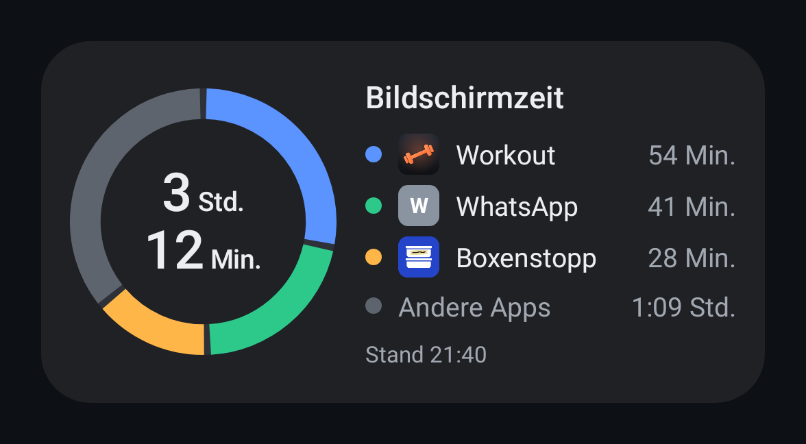

# Bildschirmzeit

> „Ich will ein eigenes Bildschirmzeit-Widget für meinen Startbildschirm
> (Samsung Galaxy S24), weil Androids Bildschirmzeit meine Web-Apps
> Boxenstopp, Freizeit und Workout nur als „Chrome“ zählt.“
>
> „Push, Daten und alles andere in den drei Apps müssen weiter funktionieren
> wie bisher.“ – Tobi

Eine kleine Android-App mit Widget: Ring mit der Bildschirmzeit von heute,
daneben die Top 3 und „Andere Apps“ – und Boxenstopp, Freizeit und Workout stehen dort unter
eigenem Namen und mit eigenem Symbol statt als „Chrome“.




Weitere Vorschauen (mit erfundenen Zahlen, von `VorschauTest` und
`AppVorschauTest` gezeichnet): `docs/vorschau-klein-*.png` (2×2, nur der
Ring), `vorschau-lang-hell.png` (3×2, lange Zeiten, ohne Netz – unter
320 dp Breite kleinerer Ring und Zeilen ohne App-Symbol, damit die Namen
ganz bleiben),
`vorschau-flach-hell.png`, `vorschau-einrichten-hell.png` (ohne Erlaubnis),
`vorschau-app-hell.png` / `-dunkel.png` (der App-Bildschirm; unten die
Update-Karte – hell noch nicht eingerichtet, dunkel eingerichtet),
`vorschau-app-einrichten-hell.png` (die App ohne Erlaubnis, mit dem Weg
über die eingeschränkte Einstellung).

## Tobis Entscheidungen

- Repo öffentlich, deshalb liegt auch der Signaturschlüssel offen im Repo
  (Risiko ist erklärt, unten „Signaturschlüssel“).
- Der Ring zeigt die Anteile der Apps: voller Ring = Gesamtzeit heute, Top 3
  farbig (blau, grün, orange), der Rest grau.
- „Hab ich wirklich nur diese drei Apps heute verwendet?“ (15.11., Widget mit
  Claude 16, Boxenstopp 6, Chrome 5 von 36 Min.) – seit Release v5 steht der
  graue Rest als vierte Zeile „Andere Apps“ da (unter 290 dp Breite „Andere“).
  Vorher: nur die Top 3, der Rest war nur grau im Ring. Ist das Widget flacher
  als 172 dp, steht er vorn im Stand („1:09 Std. andere · Stand 21:40“); ganz
  flach (unter 125 dp) fällt der Stand samt Rest weg. Dafür sind die Abstände
  der Zeilen etwas enger (5 statt 7 dp). Geprüft in VorschauTest
  `andereAppsAlsVierteZeile` (auch, dass der Stand nie abgeschnitten wird –
  bei 352 × 176 dp war er es im ersten Versuch). Tobis Widget meldet laut
  Screenshot etwa 400 × 201 dp.
- Verbunden wird aus der Widget-App (je App ein Knopf „Verbinden“); die
  Web-Apps zeigen nur „verbunden · Trennen“.
- „Alter stand? Keinen bock immer zu aktualisieren“ (15.11., 08:49, das
  Widget zeigte „Stand 08:43“) – gemeint war beides, und beides ist gebaut:
  Das Widget bleibt von selbst frisch, solange das Handy benutzt wird
  (unten „Von selbst frisch“), und die App installiert neue Versionen selbst
  (unten „Updates von selbst“).

## Einrichten auf dem S24

Einmal, alles am Handy:

1. In Chrome diesen Link öffnen:
   https://github.com/Finanzdienste/Bildschirmzeit/releases/latest/download/bildschirmzeit.apk
   → „Herunterladen“ (fragt Chrome „Datei trotzdem herunterladen?“, auch
   „Herunterladen“).
2. Unten „Öffnen“ antippen (oder die Mitteilung „Download abgeschlossen“).
   Beim ersten Mal kommt „Aus Sicherheitsgründen … unbekannte Apps …“ →
   „Einstellungen“ → „Diese Quelle zulassen“ für Chrome einschalten →
   zurück → „Installieren“.
3. Lässt One UI gar nicht installieren („Automatische Sperre“): Einstellungen
   → Sicherheit und Datenschutz → Automatische Sperre → aus, installieren –
   und erst nach Schritt 5 wieder einschalten (mit der Sperre an fehlt
   vermutlich „Eingeschränkte Einstellungen zulassen“, siehe unten). Für ein
   Update der App die Sperre wieder kurz aus.
4. Warnt Play Protect („Unsichere App blockiert“ o. Ä.): „Weitere Details“ →
   „Trotzdem installieren“. Fragt es nach einem Scan, ist beides in Ordnung.
5. „Bildschirmzeit“ öffnen. **Schritt 1** „Erlauben“ → es öffnet sich gleich
   die Seite „Zugriff auf Nutzungsdaten“ der App (auf dem S24 so gesehen) →
   Schalter ein → zurück. Ist der Schalter grau („Gesteuert durch
   eingeschränkte Einstellung“ – so bei einer APK aus Chrome):
   1. Trotzdem auf „Berechtigung erteilen“ tippen. Auf dem S24 (One UI 8) kommt
      „App wurde Zugriff verweigert … Informationen dazu, wie du den Zugriff
      erlaubst“ → „Schließen“ (auf anderen Geräten „Eingeschränkte
      Einstellung“ → „OK“). Erst danach hat die App-Info oben rechts ⋮ –
      vorher fehlt es ganz (Tobis Screenshots vom 15.11.).
   2. Die App-Info frisch öffnen: Einstellungen → Apps → Bildschirmzeit (oder
      in der App „App-Info öffnen“) → oben rechts ⋮ → „Eingeschränkte
      Einstellungen zulassen“ → mit PIN oder Fingerabdruck bestätigen.
   3. Noch einmal „Erlauben“ → Schalter ein.
   4. Fehlt ⋮ auch nach 1.: die Automatische Sperre (Schritt 3) ausschalten,
      1. und 2. wiederholen, danach die Sperre wieder ein. So der Stand am
      15.11. um 08:24 – auch nach dem Antippen kein ⋮, die Sperre war nach
      der Installation wieder an (wie Schritt 3 damals sagte).
6. **Schritt 2** – dreimal: bei Boxenstopp „Verbinden“ → die Web-App öffnet
   sich in Chrome (als installierte App oder als Tab, beides teilt sich den
   Speicher) und meldet „Bildschirmzeit verbunden …“ → zurückwischen zur
   Bildschirmzeit-App. Dasselbe für Freizeit und Workout. Danach steht dort
   „heute … Min., zuletzt 21:40“. Der Link geht ausdrücklich an Chrome, auch
   wenn Samsung Internet der Standardbrowser ist: Sonst landete die Kennung
   im Speicher von Samsung Internet, und die Web-Apps in Chrome blieben
   unverbunden. Nur ohne Chrome nimmt die App den Standardbrowser.
7. **Schritt 3** „Widget hinzufügen“ → „Hinzufügen“. Von Hand:
   Startbildschirm lange drücken → „Widgets“ → „Bildschirmzeit“ → antippen →
   „Hinzufügen“. Größe ändern: Widget lange drücken, an den Rändern ziehen
   (2×2 zeigt nur den Ring).
8. Empfohlen, damit Samsung die App nicht schlafen legt (dann stünden
   Wecker und 15-Minuten-Lauf still): Einstellungen → Apps → Bildschirmzeit
   → Akku → „Nicht eingeschränkt“. Antippen des Widgets rechnet immer sofort.
9. **Automatische Updates – einmal einrichten:** In der App unten
   „Automatische Updates einrichten“ → es öffnet sich „Unbekannte Apps
   installieren“ für Bildschirmzeit → Schalter („Diese Quelle zulassen“,
   bei Android selbst „Dieser Quelle vertrauen“) ein → zurück. Die Karte
   zeigt dann „Automatische Updates ✓“. Ab da installiert die App neue
   Versionen selbst (sie fragt GitHub alle 4 Stunden; die App schließt sich
   dabei kurz, Einstellungen, Verbindungen und Widget bleiben). Will Android
   ein Update doch einmal bestätigt haben, steht dort „Neue Version
   installieren“ → antippen → „Aktualisieren“. Klappt es nicht, sagt die
   Karte warum und was zu tun ist (z. B. bei „blockiert“: Einstellungen →
   Sicherheit und Datenschutz → Automatische Sperre → aus, dann „Noch einmal
   versuchen“).

   **Einmal noch von Hand:** Wer eine Fassung ohne diese Karte hat (Tobi:
   1.1), installiert die nächste wie in Schritt 1–4 (Automatische Sperre
   kurz aus, Link in Chrome, „Aktualisieren“) und richtet dann Schritt 9
   ein. Danach nie wieder.

## Wie gerechnet wird

**Android** (`Nutzung.kt`, getestet in `NutzungTest`): Vordergrundzeit heute,
von lokaler Mitternacht bis jetzt, aus `UsageStatsManager.queryEvents`.

- Abgefragt wird ab 8 Stunden vor Mitternacht, damit eine App, die über
  Mitternacht offen war, ab Mitternacht zählt; gezählt wird nur [Mitternacht,
  jetzt].
- Eine App ist vorn, solange eine ihrer Activities `ACTIVITY_RESUMED` hat und
  noch kein `PAUSED`/`STOPPED`. Zwei Activities derselben App zählen einmal.
- Android nennt nur die Klasse, nicht die Instanz. Alle installierten
  Web-Apps laufen in Chrome als dieselbe Klasse (`WebappActivity`); wechselt
  man direkt von Workout zu Boxenstopp, kommt `PAUSED`(Workout),
  `RESUMED`(Boxenstopp), dann erst `STOPPED`(Workout). Ein `STOPPED` nach
  einem `PAUSED` derselben Klasse schließt deshalb nichts (es ist das späte
  Ende der pausierten Instanz); nur ein `STOPPED` ohne `PAUSED` davor
  schließt. Vorher fehlte so die ganze zweite Sitzung bei Chrome (und damit
  in der Gesamtzeit) – Test `webAppsDirektNacheinanderZaehlenGanz`. Dasselbe
  gilt für Unterseiten der Einstellungen-App.
- `SCREEN_NON_INTERACTIVE`, `KEYGUARD_SHOWN` und `DEVICE_SHUTDOWN` schließen
  alles. Nach `DEVICE_STARTUP` ohne vorheriges Ausschalten (Akku leer) zählt
  das Offene nicht – wie lange es lief, weiß niemand.
- Nicht gezählt: jede HOME-Activity (Startbildschirm, Übersicht, auch der
  Notfall-Startbildschirm der Einstellungen), `com.android.systemui` und Pakete
  ohne Eintrag im App-Drawer. Die Bildschirmzeit-App selbst zählt mit. Sichtbar
  sind die Pakete über `<queries>` (MAIN/LAUNCHER, MAIN/HOME), nicht über
  `QUERIES_ALL_PACKAGES`.
- Installierte Web-Apps (Pakete `org.chromium.webapk.*`) sind nur ein
  Startknopf für Chrome; ihre Sekunden zählen zu Chrome.

**Chrome kürzen** (`Aufteilung.kt`, `AufteilungTest`): Die Widget-App liest
mit `bildschirmzeit_lesen` die letzten acht Tage und nimmt für heute, was jede
Web-App gemeldet hat. Das wird von Chrome abgezogen und als „Boxenstopp“,
„Freizeit“, „Workout“ gezeigt. Haben die drei zusammen mehr gemeldet, als
Chrome lief, werden sie anteilig auf Chromes Zeit gekürzt (Rest nach größtem
Bruchteil) – die Gesamtzeit ist also immer die von Android. Was von Chrome
übrig bleibt, steht als „Chrome“ da.

**Ohne Netz:** Es gilt, was zuletzt von Supabase kam (SharedPreferences), und
das Widget schreibt leise „Stand 21:40 · ohne Netz“ (nur wenn mindestens eine
Web-App verbunden ist).

**Wann** (`Takt.kt`, `Aktualisierung.kt`; Begründung unten „Von selbst
frisch“): ein nicht weckender Wecker alle 2 Minuten, solange das Handy
benutzt wird, und gleich nach dem Einschalten des Bildschirms; dazu
WorkManager alle 15 Minuten (unique, KEEP; nach einem Neustart plant
WorkManager selbst neu, den Wecker plant `Hintergrund` nach Neustart und
Update neu). Supabase höchstens alle 5 Minuten, bei dunklem Bildschirm
höchstens stündlich, sonst gilt der Zwischenspeicher. `updatePeriodMillis`
ist 0: Androids eigener 30-Minuten-Takt weckte das Handy auch nachts und
rechnete und funkte doppelt. Antippen schickt einen Broadcast an das
Widget, das gleich dort rechnet (`goAsync`, eigener Faden): erst ohne Netz
zeichnen, dann mit – Antippen fragt Supabase immer. Eine Sperre verhindert
zwei Rechnungen zugleich; „Alle Daten löschen“ läuft unter derselben Sperre.

**Warum Samsungs Zahl um Minuten abweichen kann:** Samsungs Digital Wellbeing
rechnet selbst und anders (eigene Zusammenfassung der Nutzungsdaten, zählt
z. B. Telefonate oder Apps ohne Symbol im App-Drawer, die hier fehlen, und
lässt dafür anderes weg; geteilter Bildschirm und Bild-im-Bild werden anders
gewertet). Das Widget zeigt den Stand seiner letzten Rechnung (während
der Benutzung höchstens gut 3 Minuten alt, Antippen holt nach). Die
Web-Apps messen nur, solange sie sichtbar sind, und melden alle 5 Minuten
und beim Wegschalten – was seit der letzten Meldung dazukam, steht bis
dahin noch bei Chrome.

## Von selbst frisch (Release nach v5)

> „Alter stand? Keinen bock immer zu aktualisieren“ – Tobi, 15.11., 08:49
> (Screenshot: „Stand 08:43“).

**Vorher:** Gerechnet wurde nur alle 15 Minuten (WorkManager, das Minimum)
und beim Antippen. Ein Stand von 6 Minuten war normal, bis zu 15 möglich.

**Jetzt:** Ein Wecker (AlarmManager, `setInexactRepeating`, Art
`ELAPSED_REALTIME` – **nicht** `_WAKEUP`) klingelt alle 2 Minuten. Er weckt
das Handy nie, braucht keine Erlaubnis für genaue Wecker und keinen Dienst
im Vordergrund. Der WorkManager-Lauf alle 15 Minuten bleibt (für
Mitternacht, wenn das Handy liegt, und für die Update-Prüfung).

**Warum das reicht – nachgelesen in AOSP (Android 16,
`AlarmManagerService`):** Ist der Bildschirm aus, hält Android nicht
weckende Wecker zurück (`checkAllowNonWakeupDelayLocked`) und stellt sie in
dem Moment zu, in dem der Bildschirm angeht (`interactiveStateChangedLocked`).
Schaut Tobi nach einer Pause aufs Handy, rechnet das Widget also sofort;
benutzt er es durchgehend, ist der Stand höchstens gut 3 Minuten alt
(ungenaue Wecker legt Android bis 75 % des Abstands zusammen: 2 bis 3½
Minuten). Eine App mit Widget auf dem Startbildschirm steht in Androids
Standby-Gruppe „aktiv“ (`AppStandbyController`, `isBoundWidgetPackage`) –
ohne Begrenzung der Wecker. Ein Update der App überleben Wecker, einen
Neustart nicht: `Hintergrund` (nicht exportiert) plant nach
`BOOT_COMPLETED` und `MY_PACKAGE_REPLACED` neu. Ohne Widget gibt es keinen
Wecker.

**Drosselung (`Takt.plan`):** Rechnen ist billig (Androids Ereignisse seit
Mitternacht, Millisekunden) – der Wecker rechnet bei jedem Klingeln, nur
nicht, wenn die letzte Rechnung keine Minute her ist. Teuer ist das Netz:
Supabase höchstens alle 5 Minuten (öfter melden die Web-Apps auch nicht),
bei dunklem Bildschirm gar nicht aus dem Wecker und aus WorkManager
höchstens stündlich; dazwischen gilt der Zwischenspeicher (ohne „ohne
Netz“ – der Stand ist ja frisch). Antippen fragt immer.

**Was es kostet, ehrlich:** Akku: Der Wecker läuft nur, wenn das Handy
ohnehin wach ist – bei angeschaltetem Bildschirm höchstens 30-mal in der
Stunde je ein paar Dutzend Millisekunden Rechnen und Zeichnen, neben dem
Bildschirm nicht messbar; bei dunklem Bildschirm hängt er sich nur an, wenn
etwas anderes das Handy weckt (dann ohne Netz). Daten: eine
Supabase-Abfrage sind einige KB (mit TLS-Aufbau grob 5–10 KB). Höchstens
12 in der Stunde, während das Handy benutzt wird, sonst höchstens eine –
bei 4 Stunden Bildschirmzeit am Tag rund 70 Abfragen, grob 0,5 MB am Tag.
Vorher waren es 96 am Tag (alle 15 Minuten, auch nachts).

**Geprüft:** `TaktTest` (die Regeln), `WeckerTest` (nicht weckend,
ungenau, 2 Minuten, Supabase nach 5 Minuten, im Dunkeln ohne Netz, neu
eingeplant nach Neustart und Update, ohne Widget kein Wecker, Empfänger
nicht exportiert). Gegen f02bb03 (v5) bauten die neuen Tests nicht (die
Klassen fehlten); ein Test nur mit Schnittstellen, die beide Fassungen
haben, war dort 3-mal rot (kein Wecker, kein Empfänger für Neustart und
Update, keine Rechte zum Installieren) und ist jetzt grün.

## Updates von selbst (Release nach v5)

> „Keinen bock immer zu aktualisieren“ – Tobi, 15.11.

**Vorher:** Die App fragte GitHub beim Öffnen; „Neue Version verfügbar“ →
„Herunterladen“ öffnete den Link im Browser, installiert wurde von Hand (und
oft erst nach dem Ausschalten der Automatischen Sperre).

**Jetzt** (`Selbstupdate.kt`, Regeln in `UpdateRegeln`): Der
WorkManager-Lauf fragt GitHub höchstens alle 4 Stunden (`releases/latest`,
ohne Token 60 Anfragen je Stunde und Adresse – im Mobilfunk teilen sich
viele eine Adresse), das Öffnen der App höchstens alle 10 Minuten. Ist das
Release neuer und Schritt 9 eingerichtet, lädt die App die APK, prüft sie
und installiert sie über eine `PackageInstaller`-Sitzung – ohne Rückfrage.
Nicht, solange die App offen ist (die Installation schließt sie), nicht
während einer laufenden Installation (Sitzung gemerkt, nach 10 Minuten
verworfen), nicht unter Android 12 (dort fragte Android jedes Mal; dann nur
der Knopf). Die Karte unten in der App zeigt den Stand; ihr Knopf ist der
einzige Weg von Hand („Automatische Updates einrichten“, „Neue Version
installieren“, „Noch einmal versuchen“; „Im Browser herunterladen“ nur,
wenn GitHub keine Prüfsumme nennt).

**Warum ohne Rückfrage – nachgelesen in AOSP (Android 16,
`PackageInstallerSession.computeUserActionRequirement`):** Android verlangt
keine Bestätigung, wenn die Sitzung `USER_ACTION_NOT_REQUIRED` setzt (ab
Android 12), die App `UPDATE_PACKAGES_WITHOUT_USER_ACTION` deklariert, die
neue APK targetSdk ≥ 33 hat (hier 36) und die App **sich selbst**
aktualisiert (`isSelfUpdate` – dafür muss sie nicht Installer of Record
sein) – und „Unbekannte Apps installieren“ für sie erlaubt ist (sonst
`isInstallDisabledForPackage` → Rückfrage). Schritt 9 ist genau diese
Erlaubnis (`REQUEST_INSTALL_PACKAGES`, `canRequestPackageInstalls()`;
sie gehört nicht zu den „eingeschränkten Einstellungen“). Ausnahme: Hat
ein anderer Installer die Update-Hoheit (Update-Owner), fragt Android
einmal nach (`REASON_REMIND_OWNERSHIP`). Diese Rückfrage zeigt die App nur
im Vordergrund – nach Tobis Tippen auf „Neue Version installieren“ und nur
Androids eigene `CONFIRM_INSTALL`-Absicht, ohne weitergereichte
Dateirechte; kommt sie im Hintergrund, wird die Sitzung verworfen und die
Karte sagt „Android will dieses Update einmal bestätigt haben“.
`setRequestUpdateOwnership` setzt die App nicht: Laut AOSP wirkt es nur bei
der Erstinstallation („on package update is a no-op“), und ein
Selbst-Update braucht keine Update-Hoheit.

**Sicher:** Geladen wird nur über HTTPS und nur
`https://github.com/Finanzdienste/Bildschirmzeit/releases/download/v<n>/bildschirmzeit.apk`
(höchstens 50 MB) in den eigenen Speicher (`noBackupFilesDir/update`).
Der SHA-256 muss mit dem Feld `digest` der GitHub-API übereinstimmen, die
Größe mit `size`; Paketname und versionCode der Datei
(`getPackageArchiveInfo`) müssen unsere und genau die Laufnummer des
Release sein, nie gleich alt oder älter. Die Signatur prüft Android (gleiche
Signatur wie die installierte App) – nichts davon wird umgangen. Der
Status-Empfänger `UpdateStatus` ist nicht exportiert, der PendingIntent
explizit und `FLAG_MUTABLE` (nur so kann Android Status und Rückfrage
eintragen; ab targetSdk 35 Pflicht). Im Log stehen nur Statuscodes – die
Kennung hat mit dem Update nichts zu tun.

**Fehlschläge:** Kein Netz, falsche Prüfsumme, keine Erlaubnis, Androids
Status (abgebrochen, blockiert – meist Samsungs Automatische Sperre –,
Konflikt, inkompatibel, beschädigt, Speicher, Zeitüberschreitung) – die
Karte nennt den Grund und den nächsten Schritt als Klickfolge. Der
Hintergrund wartet nach dem n-ten Fehlschlag 1, 2, 4, 8, 16, dann 24
Stunden; bei falscher Datei, Konflikt oder inkompatibel gar nicht mehr bis
zum nächsten Release. Der Knopf wartet nie. Ein neues Release setzt alles
zurück.

**Was es kostet:** höchstens 6 Anfragen an GitHub am Tag aus dem
Hintergrund (je rund 4 KB), dazu beim Öffnen der App; die APK (rund
0,75 MB) einmal je Release.

**Geprüft:** `UpdateRegelnTest` (Prüfsumme, Fassung, Wartezeit, Status →
Text, die Karte), `SelbstupdateTest` (der ganze Weg auf einem
nachgebauten Gerät: installiert ohne Rückfrage, falsche Prüfsumme →
nichts, ohne Erlaubnis kein Download, nie gleich alt oder älter, GitHub
höchstens alle 4 Stunden, kein zweites Update während eines laufenden,
Wartezeit nach Fehlern, Rückfrage im Hintergrund verworfen und im
Vordergrund nur nach dem Knopf gezeigt, Karte → Einstellungen →
Installieren), `DatenTest` (die Antwort von GitHub, nur Adressen dieses
Repos), `WeckerTest` (Rechte im Manifest). Mutationen (Prüfsumme weg,
Rückfrage auch ohne Knopf, Wartezeit weg, zweite Sitzung erlaubt, Wecker
weckend) machen je mindestens einen Test rot. Nie das echte GitHub
(`Netz.gesperrt`, Abruf und Download in den Tests ersetzt).

**Zeigt sich erst auf dem S24:** ob One UI 8 das Selbst-Update wirklich ohne
Rückfrage durchlässt (AOSP sagt ja), ob die mit „Eigene Dateien“
installierte Fassung einen Update-Owner hat (dann kommt beim ersten Mal
die Rückfrage über den Knopf), ob die Automatische Sperre Updates der App
blockiert oder den Schalter in Schritt 9 sperrt, ob Play Protect warnt,
und wie genau der Schalter heißt.

## Der Vertrag zwischen Widget-App, Supabase und Web-Apps

**Supabase** – Projekt `vjyohppohmvhhxgwouti` („Finanzdienste's Project“),
Quelle `supabase/bildschirmzeit.sql` (live als Migration „bildschirmzeit“),
geprüft von `tests/test-sql.mjs` (PGlite). URL
`https://vjyohppohmvhhxgwouti.supabase.co`, öffentlicher Schlüssel
`sb_publishable_wTUNShIKMFjCOmZzQuuN-A_vFHPkKUI` – nur als Kopf `apikey`,
kein `Authorization` (es ist kein JWT).

| Funktion (`POST /rest/v1/rpc/…`) | Wer | Eingabe | Antwort |
|---|---|---|---|
| `bildschirmzeit_anmelden` | Widget-App | `p_kennung` | `true` |
| `bildschirmzeit_melden` | Web-Apps | `p_kennung`, `p_app` (`boxenstopp`/`freizeit`/`workout`), `p_tage` `{"JJJJ-MM-TT": sekunden}` | `true`; `false` = Kennung nicht (mehr) angemeldet |
| `bildschirmzeit_lesen` | Widget-App | `p_kennung`, `p_von`, `p_bis` (≤ 62 Tage) | `[{app, tag, sekunden, aktualisiert}]` |
| `bildschirmzeit_loeschen` | Widget-App | `p_kennung` | `true`/`false`; danach meldet `melden` `false` |

Je Tag gilt der größere Wert (Tagesstand, kein Zuwachs). Tage außerhalb
heute − 8 … heute + 1 (UTC) fallen still weg, mehr als 10 Tage auf einmal
sind ein Fehler. Gespeichert wird nur der SHA-256 der Kennung.

**Kennung:** 32 zufällige Byte (SecureRandom) als base64url ohne „=“, 43
Zeichen (`^[A-Za-z0-9_-]{32,128}$`), einmal von der Widget-App erzeugt und in
ihren SharedPreferences gehalten. Geheim: nie loggen, nie in Commits oder
Tests mit echten Werten. Sie geht weder in die Cloud-Sicherung noch beim
Handywechsel mit (`datenregeln.xml`) – auf einem neuen Handy einfach neu
verbinden.

**Verbinden-Link** (öffnet die Web-App, die sich dann an die Kennung bindet):
`https://finanzdienste.github.io/Boxenstopp/#bildschirmzeit=<Kennung>`,
dasselbe mit `/Freizeit/` und `/Workout/`. Alle drei liegen auf
`finanzdienste.github.io` und teilen sich den localStorage. Vor dem Öffnen
stellt die App sicher, dass `bildschirmzeit_anmelden` durch ist.

**Mess-Modul der Web-Apps:** `web/bildschirmzeit.js`, geprüft von
`tests/test-web.mjs` (ohne Browser). Boxenstopp, Freizeit und Workout haben je
eine **byte-gleiche** Kopie als `js/bildschirmzeit.js` – geändert wird nur
hier, dann in alle drei kopiert (dort jeweils die Service-Worker-Version
hochzählen und die Browsertests laufen lassen). Ohne Link ist es völlig
still. Mit Link misst es nur sichtbare Zeit (Takt 15 s, Lücke höchstens
60 s), teilt an Mitternacht, schickt alle 5 Minuten, beim Zurückkommen und
beim Wegschalten (keepalive), gleich nach dem Verbinden auch heute = 0 –
daran sieht die Widget-App „verbunden“. Antwortet Supabase `false`, trennt es
sich selbst („Bildschirmzeit getrennt: …“). API: `bildschirmzeitStarten(name,
{ meldung, verstecken })`, `bildschirmzeitStand()`, `bildschirmzeitTrennen()`,
`bildschirmzeitSenden({ keepalive })`, `bildschirmzeitVerstecken()`,
`dauerText(sek)` (wortgleich mit `dauerText` in `Texte.kt`), `BZ_EREIGNIS`.

**„Alle Daten löschen“** (unten in der App, mit Rückfrage):
`bildschirmzeit_loeschen`, dann eine neue Kennung (gleich angemeldet). Die
Web-Apps bekommen beim nächsten Melden `false` und trennen sich von selbst;
danach kann man sie neu verbinden. „verbunden“ heißt in der App: in den
letzten acht Tagen gemeldet – wer in einer Web-App „Trennen“ drückt, steht
deshalb noch bis zu acht Tage als verbunden da (die Zahlen bleiben bei
Supabase).

## Signaturschlüssel – offen im Repo

`android/signatur/bildschirmzeit.p12` (PKCS12, Alias `bildschirmzeit`,
Passwort `bildschirmzeit-oeffentlich`, RSA 4096, gültig bis 2126,
SHA-256 `BC:6F:91:B9:8B:B1:76:7F:93:D5:F1:4F:9C:EA:F8:6C:A6:35:5F:61:59:5C:CE:62:1E:65:10:3C:3B:AA:75:9E`).
Passwort und Pfad stehen in `android/app/build.gradle.kts`.

**Warum:** Android installiert ein Update nur über die alte App, wenn beide
mit demselben Schlüssel signiert sind. Tobi hat keinen PC; gebaut wird in
GitHub Actions, und so braucht der Bau keine Geheimnisse (keine Secrets, die
verloren gehen oder in einer neuen Sitzung fehlen) – jede Fassung lässt sich
über die vorige installieren.

**Was das bedeutet:** Jeder kann eine APK bauen, die Android als „Update“ von
Bildschirmzeit annimmt. Schaden kann sie nur, wenn sie installiert wird –
deshalb nur über den Link oben oder die App selbst aktualisieren (beide
nehmen nur die Releases dieses Repos). Seit den Updates von selbst heißt
das: Wer hier ein Release veröffentlichen kann (Schreibrecht aufs Repo, also
ein Push auf `main`), bringt Code auf Tobis Handy, ohne dass er tippt. Das
war vorher auch so, nur mit Tobis „Aktualisieren“ dazwischen. Die App hat
Nutzungsdaten, Internet und darf (nach Schritt 9) Apps installieren – sie
installiert nur sich selbst, aber eine untergeschobene Fassung könnte diese
Nutzungsdaten lesen, die Kennung (also die Minuten der drei Web-Apps) kennen
und andere APKs zur Installation anbieten. Wird der Schlüssel je getauscht, muss Tobi die App einmal
deinstallieren und neu installieren (neue Kennung, neu verbinden).

## Aufbau

```
gradlew, gradle/wrapper/     Gradle-Wrapper (9.9.1) – immer mit -p android
android/                     Gradle-Projekt (Kotlin DSL)
  gradle/libs.versions.toml  alle Versionen an einer Stelle
  signatur/bildschirmzeit.p12  der offene Signaturschlüssel
  app/src/main/kotlin/de/finanzdienste/bildschirmzeit/
    Nutzung.kt               die Rechnung über Androids Ereignisse (rein)
    Aufteilung.kt            Chrome kürzen, die drei Web-Apps (rein)
    Texte.kt                 Zeiten, Kennung (rein)
    Ring.kt                  Ring-Geometrie und -Bild
    Nutzungsdaten.kt         UsageStatsManager, Launcher, HOME, Erlaubnis
    Netz.kt                  HttpURLConnection + org.json, Supabase, Zeilen
    Speicher.kt              SharedPreferences: Kennung, Zwischenspeicher
    Rechner.kt               setzt alles zu einem Ergebnis zusammen
    WidgetAnsicht.kt         RemoteViews: 4×2, 2×2, „Tippen zum Einrichten“
    Aktualisierung.kt        WorkManager, Widget-Empfänger, Sperre
    Takt.kt                  wann gerechnet und gefunkt wird (rein), Wecker, Neustart/Update
    NeueVersion.kt           GitHub releases/latest: Laufnummer, APK, Prüfsumme
    Selbstupdate.kt          Updates von selbst: Regeln (rein), Laden, Installer-Sitzung, Status
    MainActivity.kt          der App-Bildschirm
  app/src/test/…             JUnit + Robolectric (Vorschau mit nativer Grafik)
docs/vorschau-*.png          gezeichnet von den Tests
supabase/bildschirmzeit.sql  die vier Funktionen
web/bildschirmzeit.js        das Mess-Modul der drei Web-Apps
tests/                       test-sql.mjs (PGlite), test-web.mjs
.github/workflows/apk.yml    pruefen → apk → Release v<Laufnummer>
```

Versionen: Android-Gradle-Plugin 9.5.1 (mit eingebautem Kotlin), Kotlin
2.4.21, Gradle 9.9.1, compileSdk 37, targetSdk 36 (Android 16, was das S24
hat; 37 erst nach einer Prüfung auf dem Gerät), minSdk 29, JDK 21 (Ziel 17).
Abhängigkeiten: androidx.core 1.19.1, androidx.work 2.12.0 (Wecker und
Installer sind Android selbst, keine weitere Bibliothek); Tests JUnit
4.13.2, Robolectric 4.18. Die Release-APK ist mit R8 verkleinert (rund
0,75 MB).

## Bauen und testen

GitHub Actions (`apk.yml`, bei jedem Push auf `main` und von Hand): Job
`pruefen` (`npm ci`, `node tests/test-sql.mjs`, `node tests/test-web.mjs`),
dann `apk` (`./gradlew -p android testReleaseUnitTest
assembleRelease`, `apksigner verify`, Artefakt `bildschirmzeit-apk`, Release
`v<Laufnummer>` mit `bildschirmzeit.apk` als „latest“; dazu das Artefakt
`vorschau` mit den neu gezeichneten Bildern und Testberichten). Die
Laufnummer ist der `versionCode`, `versionName` ist `1.<Laufnummer>`.

Lokal (oder in einer Cloud-Sitzung):

```sh
npm ci && node tests/test-sql.mjs && node tests/test-web.mjs

# einmal: Android-SDK nach ~/.android-sdk
curl -LO https://dl.google.com/android/repository/commandlinetools-linux-16111833_latest.zip
mkdir -p ~/.android-sdk/cmdline-tools && unzip -q commandlinetools-*.zip -d ~/.android-sdk/cmdline-tools
mv ~/.android-sdk/cmdline-tools/cmdline-tools ~/.android-sdk/cmdline-tools/latest
yes | ~/.android-sdk/cmdline-tools/latest/bin/sdkmanager --licenses
~/.android-sdk/cmdline-tools/latest/bin/sdkmanager "platforms;android-37.0" "build-tools;36.0.0"
echo "sdk.dir=$HOME/.android-sdk" > android/local.properties

./gradlew -p android testReleaseUnitTest assembleRelease
~/.android-sdk/build-tools/36.0.0/apksigner verify --verbose android/app/build/outputs/apk/release/app-release.apk
```

Die Tests schreiben die Vorschau neu nach `docs/` – nach einer Änderung am
Widget die Bilder ansehen und mit committen. Die App-Vorschau zeigt eine
feste Version („1.22“), damit ein Bau mit anderer Laufnummer die Bilder
nicht ändert. Die Bilder für die
Widget-Auswahl (`res/drawable-nodpi/widget_vorschau.png`, `-night-`) kommen
aus `android/app/build/vorschau/` und werden von Hand kopiert. Kein Test
spricht mit dem echten Supabase oder GitHub (`Netz.gesperrt`).

## Stand

- 15.11.2026: Release **v1** (Fassung 1.1, aus 4593f43) liegt unter dem
  APK-Link oben – in Actions gebaut, 72 JUnit-/Robolectric-Prüfungen, 47 SQL,
  61 Web-Modul grün, Zertifikat-SHA-256 `bc6f91b9…759e` wie oben. Supabase
  ist live eingespielt und geprüft. Die drei Web-Apps sind angebunden:
  Workout v263, Boxenstopp v78, Freizeit v42 (je `js/bildschirmzeit.js`,
  byte-gleich mit `web/bildschirmzeit.js`).
- Reine Doku-Commits mit „[skip ci]“ in der Nachricht: Sonst baut jeder Push
  ein neues Release, und die App installiert es ohne Änderung (seit den
  Updates von selbst; vorher meldete sie „Neue Version verfügbar“).
- 15.11.2026, auf dem S24 (Tobis Screenshots): „Erlauben“ öffnet direkt die
  Seite „Zugriff auf Nutzungsdaten“ der App. Der Schalter ist dort grau
  („Gesteuert durch eingeschränkte Einstellung“), und die App-Info hat
  zunächst kein ⋮ – Android zeigt „Eingeschränkte Einstellungen zulassen“
  erst, nachdem man den grauen Schalter einmal angetippt hat. Der Hinweis in
  der App nennt diesen Schritt zuerst (seit Release v2, AppVorschauTest
  `ohneErlaubnisErstDenGrauenSchalterAntippen`). Um 08:24 fehlte ⋮ trotzdem
  noch; Verdacht: die Automatische Sperre, die laut Schritt 3 nach der
  Installation wieder an war. Seit Release v3 nennt der Hinweis das, dazu den
  Weg über Einstellungen → Apps (ob die App-Info, aus der App geöffnet, das
  Menü zeigt, ist bei Samsung nicht sicher). Um 08:39 kam beim Antippen
  „App wurde Zugriff verweigert“ → „Schließen“, um 08:40 zeigte das Widget
  Zahlen (36 Min.) – die Freigabe ging also. Ob die Automatische Sperre
  dabei aus sein musste, ist nicht bekannt.
- 15.11.2026, nach Tobis „Alter stand? Keinen bock immer zu aktualisieren“
  (08:49, Widget „Stand 08:43“, v5 noch nicht installiert): Wecker alle 2
  Minuten und Updates von selbst gebaut (die zwei Abschnitte oben) – im
  nächsten Release nach v5. 108 JUnit-/Robolectric-Prüfungen grün (vorher 75), Lint
  ohne Fehler, die Widget-Bilder unverändert, die App-Bilder mit der neuen
  Update-Karte. Tobi hat 1.1: Diese Fassung installiert er noch einmal von
  Hand und richtet dann Schritt 9 ein (Klickfolge oben).
- Noch nicht auf dem S24 ausprobiert: Größen des Startbildschirms, Akku-
  Verhalten von One UI (ob es die App trotz Widget schlafen legt), ob
  Chrome den Verbinden-Link in der installierten Web-App oder als Tab
  öffnet (beides teilt sich den Speicher), und alles unter „Zeigt sich erst
  auf dem S24“ bei den Updates.
