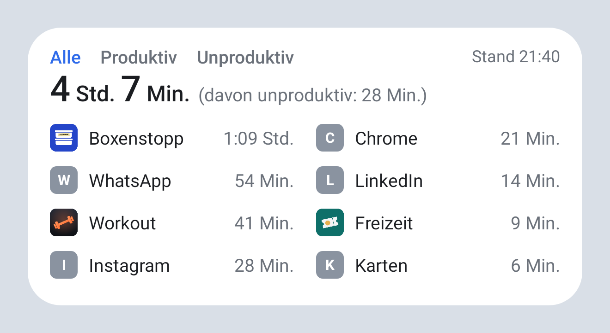

# Bildschirmzeit

> „Ich will ein eigenes Bildschirmzeit-Widget für meinen Startbildschirm
> (Samsung Galaxy S24), weil Androids Bildschirmzeit meine Web-Apps
> Boxenstopp, Freizeit und Workout nur als „Chrome“ zählt.“
>
> „Push, Daten und alles andere in den drei Apps müssen weiter funktionieren
> wie bisher.“ – Tobi

Eine kleine Android-App mit Widget: Ring mit der Bildschirmzeit von heute,
daneben die Top 3 – und Boxenstopp, Freizeit und Workout stehen dort unter
eigenem Namen und mit eigenem Symbol statt als „Chrome“.




Weitere Vorschauen (mit erfundenen Zahlen, von `VorschauTest` und
`AppVorschauTest` gezeichnet): `docs/vorschau-klein-*.png` (2×2, nur der
Ring), `vorschau-lang-hell.png` (3×2, lange Zeiten, ohne Netz – unter
320 dp Breite kleinerer Ring und Zeilen ohne App-Symbol, damit die Namen
ganz bleiben),
`vorschau-flach-hell.png`, `vorschau-einrichten-hell.png` (ohne Erlaubnis),
`vorschau-app-hell.png` / `-dunkel.png` (der App-Bildschirm),
`vorschau-app-einrichten-hell.png` (die App ohne Erlaubnis, mit dem Weg
über die eingeschränkte Einstellung).

## Tobis Entscheidungen

- Repo öffentlich, deshalb liegt auch der Signaturschlüssel offen im Repo
  (Risiko ist erklärt, unten „Signaturschlüssel“).
- Der Ring zeigt die Anteile der Apps: voller Ring = Gesamtzeit heute, Top 3
  farbig (blau, grün, orange), der Rest grau.
- Verbunden wird aus der Widget-App (je App ein Knopf „Verbinden“); die
  Web-Apps zeigen nur „verbunden · Trennen“.

## Einrichten auf dem S24

Einmal, alles am Handy:

1. In Chrome diesen Link öffnen:
   https://github.com/Finanzdienste/Bildschirmzeit/releases/latest/download/bildschirmzeit.apk
   → „Herunterladen“ (fragt Chrome „Datei trotzdem herunterladen?“, auch
   „Herunterladen“).
2. Unten „Öffnen“ antippen (oder die Mitteilung „Download abgeschlossen“).
   Beim ersten Mal kommt „Aus Sicherheitsgründen … unbekannte Apps …“ →
   „Einstellungen“ → „Diese Quelle zulassen“ für Chrome einschalten →
   zurück → „Installieren“.
3. Lässt One UI gar nicht installieren („Automatische Sperre“): Einstellungen
   → Sicherheit und Datenschutz → Automatische Sperre → aus, installieren –
   und erst nach Schritt 5 wieder einschalten (mit der Sperre an fehlt
   vermutlich „Eingeschränkte Einstellungen zulassen“, siehe unten). Für ein
   Update der App die Sperre wieder kurz aus.
4. Warnt Play Protect („Unsichere App blockiert“ o. Ä.): „Weitere Details“ →
   „Trotzdem installieren“. Fragt es nach einem Scan, ist beides in Ordnung.
5. „Bildschirmzeit“ öffnen. **Schritt 1** „Erlauben“ → es öffnet sich gleich
   die Seite „Zugriff auf Nutzungsdaten“ der App (auf dem S24 so gesehen) →
   Schalter ein → zurück. Ist der Schalter grau („Gesteuert durch
   eingeschränkte Einstellung“ – so bei einer APK aus Chrome):
   1. Trotzdem auf „Berechtigung erteilen“ tippen, den Hinweis „Eingeschränkte
      Einstellung“ mit „OK“ schließen. Erst danach hat die App-Info oben
      rechts ⋮ – vorher fehlt es ganz (Tobis Screenshot vom 15.11.).
   2. Die App-Info frisch öffnen: Einstellungen → Apps → Bildschirmzeit (oder
      in der App „App-Info öffnen“) → oben rechts ⋮ → „Eingeschränkte
      Einstellungen zulassen“ → mit PIN oder Fingerabdruck bestätigen.
   3. Noch einmal „Erlauben“ → Schalter ein.
   4. Fehlt ⋮ auch nach 1.: die Automatische Sperre (Schritt 3) ausschalten,
      1. und 2. wiederholen, danach die Sperre wieder ein. So der Stand am
      15.11. um 08:24 – auch nach dem Antippen kein ⋮, die Sperre war nach
      der Installation wieder an (wie Schritt 3 damals sagte).
6. **Schritt 2** – dreimal: bei Boxenstopp „Verbinden“ → die Web-App öffnet
   sich in Chrome (als installierte App oder als Tab, beides teilt sich den
   Speicher) und meldet „Bildschirmzeit verbunden …“ → zurückwischen zur
   Bildschirmzeit-App. Dasselbe für Freizeit und Workout. Danach steht dort
   „heute … Min., zuletzt 21:40“. Der Link geht ausdrücklich an Chrome, auch
   wenn Samsung Internet der Standardbrowser ist: Sonst landete die Kennung
   im Speicher von Samsung Internet, und die Web-Apps in Chrome blieben
   unverbunden. Nur ohne Chrome nimmt die App den Standardbrowser.
7. **Schritt 3** „Widget hinzufügen“ → „Hinzufügen“. Von Hand:
   Startbildschirm lange drücken → „Widgets“ → „Bildschirmzeit“ → antippen →
   „Hinzufügen“. Größe ändern: Widget lange drücken, an den Rändern ziehen
   (2×2 zeigt nur den Ring).
8. Empfohlen, damit es alle 15 Minuten neu rechnet: Einstellungen → Apps →
   Bildschirmzeit → Akku → „Nicht eingeschränkt“. Antippen des Widgets
   rechnet immer sofort.
9. **Updates:** Gibt es eine neue Fassung, steht in der App unten „Neue
   Version verfügbar“ → „Herunterladen“ → Datei öffnen → „Aktualisieren“.
   Einstellungen, Verbindung und Widget bleiben.

## Wie gerechnet wird

**Android** (`Nutzung.kt`, getestet in `NutzungTest`): Vordergrundzeit heute,
von lokaler Mitternacht bis jetzt, aus `UsageStatsManager.queryEvents`.

- Abgefragt wird ab 8 Stunden vor Mitternacht, damit eine App, die über
  Mitternacht offen war, ab Mitternacht zählt; gezählt wird nur [Mitternacht,
  jetzt].
- Eine App ist vorn, solange eine ihrer Activities `ACTIVITY_RESUMED` hat und
  noch kein `PAUSED`/`STOPPED`. Zwei Activities derselben App zählen einmal.
- Android nennt nur die Klasse, nicht die Instanz. Alle installierten
  Web-Apps laufen in Chrome als dieselbe Klasse (`WebappActivity`); wechselt
  man direkt von Workout zu Boxenstopp, kommt `PAUSED`(Workout),
  `RESUMED`(Boxenstopp), dann erst `STOPPED`(Workout). Ein `STOPPED` nach
  einem `PAUSED` derselben Klasse schließt deshalb nichts (es ist das späte
  Ende der pausierten Instanz); nur ein `STOPPED` ohne `PAUSED` davor
  schließt. Vorher fehlte so die ganze zweite Sitzung bei Chrome (und damit
  in der Gesamtzeit) – Test `webAppsDirektNacheinanderZaehlenGanz`. Dasselbe
  gilt für Unterseiten der Einstellungen-App.
- `SCREEN_NON_INTERACTIVE`, `KEYGUARD_SHOWN` und `DEVICE_SHUTDOWN` schließen
  alles. Nach `DEVICE_STARTUP` ohne vorheriges Ausschalten (Akku leer) zählt
  das Offene nicht – wie lange es lief, weiß niemand.
- Nicht gezählt: jede HOME-Activity (Startbildschirm, Übersicht, auch der
  Notfall-Startbildschirm der Einstellungen), `com.android.systemui` und Pakete
  ohne Eintrag im App-Drawer. Die Bildschirmzeit-App selbst zählt mit. Sichtbar
  sind die Pakete über `<queries>` (MAIN/LAUNCHER, MAIN/HOME), nicht über
  `QUERIES_ALL_PACKAGES`.
- Installierte Web-Apps (Pakete `org.chromium.webapk.*`) sind nur ein
  Startknopf für Chrome; ihre Sekunden zählen zu Chrome.

**Chrome kürzen** (`Aufteilung.kt`, `AufteilungTest`): Die Widget-App liest
mit `bildschirmzeit_lesen` die letzten acht Tage und nimmt für heute, was jede
Web-App gemeldet hat. Das wird von Chrome abgezogen und als „Boxenstopp“,
„Freizeit“, „Workout“ gezeigt. Haben die drei zusammen mehr gemeldet, als
Chrome lief, werden sie anteilig auf Chromes Zeit gekürzt (Rest nach größtem
Bruchteil) – die Gesamtzeit ist also immer die von Android. Was von Chrome
übrig bleibt, steht als „Chrome“ da.

**Ohne Netz:** Es gilt, was zuletzt von Supabase kam (SharedPreferences), und
das Widget schreibt leise „Stand 21:40 · ohne Netz“ (nur wenn mindestens eine
Web-App verbunden ist).

**Wann:** WorkManager alle 15 Minuten (unique, KEEP; eingeplant beim ersten
Widget, beim App-Start; nach einem Neustart plant WorkManager selbst neu).
`updatePeriodMillis` ist 0: Androids eigener 30-Minuten-Takt weckte das
Handy auch nachts und rechnete und funkte doppelt. Antippen schickt
einen Broadcast an das Widget, das gleich dort rechnet (`goAsync`, eigener
Faden): erst ohne Netz zeichnen, dann mit. Eine Sperre verhindert zwei
Rechnungen zugleich; „Alle Daten löschen“ läuft unter derselben Sperre.

**Warum Samsungs Zahl um Minuten abweichen kann:** Samsungs Digital Wellbeing
rechnet selbst und anders (eigene Zusammenfassung der Nutzungsdaten, zählt
z. B. Telefonate oder Apps ohne Symbol im App-Drawer, die hier fehlen, und
lässt dafür anderes weg; geteilter Bildschirm und Bild-im-Bild werden anders
gewertet). Das Widget zeigt den Stand seiner letzten Rechnung (bis zu 15
Minuten alt, Antippen holt nach). Die Web-Apps messen nur, solange sie
sichtbar sind, und melden alle 5 Minuten und beim Wegschalten – was seit der
letzten Meldung dazukam, steht bis dahin noch bei Chrome.

## Der Vertrag zwischen Widget-App, Supabase und Web-Apps

**Supabase** – Projekt `vjyohppohmvhhxgwouti` („Finanzdienste's Project“),
Quelle `supabase/bildschirmzeit.sql` (live als Migration „bildschirmzeit“),
geprüft von `tests/test-sql.mjs` (PGlite). URL
`https://vjyohppohmvhhxgwouti.supabase.co`, öffentlicher Schlüssel
`sb_publishable_wTUNShIKMFjCOmZzQuuN-A_vFHPkKUI` – nur als Kopf `apikey`,
kein `Authorization` (es ist kein JWT).

| Funktion (`POST /rest/v1/rpc/…`) | Wer | Eingabe | Antwort |
|---|---|---|---|
| `bildschirmzeit_anmelden` | Widget-App | `p_kennung` | `true` |
| `bildschirmzeit_melden` | Web-Apps | `p_kennung`, `p_app` (`boxenstopp`/`freizeit`/`workout`), `p_tage` `{"JJJJ-MM-TT": sekunden}` | `true`; `false` = Kennung nicht (mehr) angemeldet |
| `bildschirmzeit_lesen` | Widget-App | `p_kennung`, `p_von`, `p_bis` (≤ 62 Tage) | `[{app, tag, sekunden, aktualisiert}]` |
| `bildschirmzeit_loeschen` | Widget-App | `p_kennung` | `true`/`false`; danach meldet `melden` `false` |

Je Tag gilt der größere Wert (Tagesstand, kein Zuwachs). Tage außerhalb
heute − 8 … heute + 1 (UTC) fallen still weg, mehr als 10 Tage auf einmal
sind ein Fehler. Gespeichert wird nur der SHA-256 der Kennung.

**Kennung:** 32 zufällige Byte (SecureRandom) als base64url ohne „=“, 43
Zeichen (`^[A-Za-z0-9_-]{32,128}$`), einmal von der Widget-App erzeugt und in
ihren SharedPreferences gehalten. Geheim: nie loggen, nie in Commits oder
Tests mit echten Werten. Sie geht weder in die Cloud-Sicherung noch beim
Handywechsel mit (`datenregeln.xml`) – auf einem neuen Handy einfach neu
verbinden.

**Verbinden-Link** (öffnet die Web-App, die sich dann an die Kennung bindet):
`https://finanzdienste.github.io/Boxenstopp/#bildschirmzeit=<Kennung>`,
dasselbe mit `/Freizeit/` und `/Workout/`. Alle drei liegen auf
`finanzdienste.github.io` und teilen sich den localStorage. Vor dem Öffnen
stellt die App sicher, dass `bildschirmzeit_anmelden` durch ist.

**Mess-Modul der Web-Apps:** `web/bildschirmzeit.js`, geprüft von
`tests/test-web.mjs` (ohne Browser). Boxenstopp, Freizeit und Workout haben je
eine **byte-gleiche** Kopie als `js/bildschirmzeit.js` – geändert wird nur
hier, dann in alle drei kopiert (dort jeweils die Service-Worker-Version
hochzählen und die Browsertests laufen lassen). Ohne Link ist es völlig
still. Mit Link misst es nur sichtbare Zeit (Takt 15 s, Lücke höchstens
60 s), teilt an Mitternacht, schickt alle 5 Minuten, beim Zurückkommen und
beim Wegschalten (keepalive), gleich nach dem Verbinden auch heute = 0 –
daran sieht die Widget-App „verbunden“. Antwortet Supabase `false`, trennt es
sich selbst („Bildschirmzeit getrennt: …“). API: `bildschirmzeitStarten(name,
{ meldung, verstecken })`, `bildschirmzeitStand()`, `bildschirmzeitTrennen()`,
`bildschirmzeitSenden({ keepalive })`, `bildschirmzeitVerstecken()`,
`dauerText(sek)` (wortgleich mit `dauerText` in `Texte.kt`), `BZ_EREIGNIS`.

**„Alle Daten löschen“** (unten in der App, mit Rückfrage):
`bildschirmzeit_loeschen`, dann eine neue Kennung (gleich angemeldet). Die
Web-Apps bekommen beim nächsten Melden `false` und trennen sich von selbst;
danach kann man sie neu verbinden. „verbunden“ heißt in der App: in den
letzten acht Tagen gemeldet – wer in einer Web-App „Trennen“ drückt, steht
deshalb noch bis zu acht Tage als verbunden da (die Zahlen bleiben bei
Supabase).

## Signaturschlüssel – offen im Repo

`android/signatur/bildschirmzeit.p12` (PKCS12, Alias `bildschirmzeit`,
Passwort `bildschirmzeit-oeffentlich`, RSA 4096, gültig bis 2126,
SHA-256 `BC:6F:91:B9:8B:B1:76:7F:93:D5:F1:4F:9C:EA:F8:6C:A6:35:5F:61:59:5C:CE:62:1E:65:10:3C:3B:AA:75:9E`).
Passwort und Pfad stehen in `android/app/build.gradle.kts`.

**Warum:** Android installiert ein Update nur über die alte App, wenn beide
mit demselben Schlüssel signiert sind. Tobi hat keinen PC; gebaut wird in
GitHub Actions, und so braucht der Bau keine Geheimnisse (keine Secrets, die
verloren gehen oder in einer neuen Sitzung fehlen) – jede Fassung lässt sich
über die vorige installieren.

**Was das bedeutet:** Jeder kann eine APK bauen, die Android als „Update“ von
Bildschirmzeit annimmt. Schaden kann sie nur, wenn Tobi sie selbst
installiert – deshalb nur über den Link oben oder „Neue Version verfügbar“
in der App aktualisieren (beide zeigen auf die Releases dieses Repos). Die
App hat nur Nutzungsdaten und Internet; eine untergeschobene Fassung könnte
diese Nutzungsdaten lesen und die Kennung (also die Minuten der drei
Web-Apps) kennen. Wird der Schlüssel je getauscht, muss Tobi die App einmal
deinstallieren und neu installieren (neue Kennung, neu verbinden).

## Aufbau

```
gradlew, gradle/wrapper/     Gradle-Wrapper (9.9.1) – immer mit -p android
android/                     Gradle-Projekt (Kotlin DSL)
  gradle/libs.versions.toml  alle Versionen an einer Stelle
  signatur/bildschirmzeit.p12  der offene Signaturschlüssel
  app/src/main/kotlin/de/finanzdienste/bildschirmzeit/
    Nutzung.kt               die Rechnung über Androids Ereignisse (rein)
    Aufteilung.kt            Chrome kürzen, die drei Web-Apps (rein)
    Texte.kt                 Zeiten, Kennung (rein)
    Ring.kt                  Ring-Geometrie und -Bild
    Nutzungsdaten.kt         UsageStatsManager, Launcher, HOME, Erlaubnis
    Netz.kt                  HttpURLConnection + org.json, Supabase, Zeilen
    Speicher.kt              SharedPreferences: Kennung, Zwischenspeicher
    Rechner.kt               setzt alles zu einem Ergebnis zusammen
    WidgetAnsicht.kt         RemoteViews: 4×2, 2×2, „Tippen zum Einrichten“
    Aktualisierung.kt        WorkManager, Widget-Empfänger, Sperre
    NeueVersion.kt           GitHub releases/latest
    MainActivity.kt          der App-Bildschirm
  app/src/test/…             JUnit + Robolectric (Vorschau mit nativer Grafik)
docs/vorschau-*.png          gezeichnet von den Tests
supabase/bildschirmzeit.sql  die vier Funktionen
web/bildschirmzeit.js        das Mess-Modul der drei Web-Apps
tests/                       test-sql.mjs (PGlite), test-web.mjs
.github/workflows/apk.yml    pruefen → apk → Release v<Laufnummer>
```

Versionen: Android-Gradle-Plugin 9.5.1 (mit eingebautem Kotlin), Kotlin
2.4.21, Gradle 9.9.1, compileSdk 37, targetSdk 36 (Android 16, was das S24
hat; 37 erst nach einer Prüfung auf dem Gerät), minSdk 29, JDK 21 (Ziel 17).
Abhängigkeiten: androidx.core 1.19.1, androidx.work 2.12.0; Tests JUnit
4.13.2, Robolectric 4.18. Die Release-APK ist mit R8 verkleinert (rund
0,75 MB).

## Bauen und testen

GitHub Actions (`apk.yml`, bei jedem Push auf `main` und von Hand): Job
`pruefen` (`npm ci`, `node tests/test-sql.mjs`, `node tests/test-web.mjs`),
dann `apk` (`./gradlew -p android testReleaseUnitTest
assembleRelease`, `apksigner verify`, Artefakt `bildschirmzeit-apk`, Release
`v<Laufnummer>` mit `bildschirmzeit.apk` als „latest“; dazu das Artefakt
`vorschau` mit den neu gezeichneten Bildern und Testberichten). Die
Laufnummer ist der `versionCode`, `versionName` ist `1.<Laufnummer>`.

Lokal (oder in einer Cloud-Sitzung):

```sh
npm ci && node tests/test-sql.mjs && node tests/test-web.mjs

# einmal: Android-SDK nach ~/.android-sdk
curl -LO https://dl.google.com/android/repository/commandlinetools-linux-16111833_latest.zip
mkdir -p ~/.android-sdk/cmdline-tools && unzip -q commandlinetools-*.zip -d ~/.android-sdk/cmdline-tools
mv ~/.android-sdk/cmdline-tools/cmdline-tools ~/.android-sdk/cmdline-tools/latest
yes | ~/.android-sdk/cmdline-tools/latest/bin/sdkmanager --licenses
~/.android-sdk/cmdline-tools/latest/bin/sdkmanager "platforms;android-37.0" "build-tools;36.0.0"
echo "sdk.dir=$HOME/.android-sdk" > android/local.properties

./gradlew -p android testReleaseUnitTest assembleRelease
~/.android-sdk/build-tools/36.0.0/apksigner verify --verbose android/app/build/outputs/apk/release/app-release.apk
```

Die Tests schreiben die Vorschau neu nach `docs/` – nach einer Änderung am
Widget die Bilder ansehen und mit committen. Die App-Vorschau zeigt eine
feste Version („1.22“), damit ein Bau mit anderer Laufnummer die Bilder
nicht ändert. Die Bilder für die
Widget-Auswahl (`res/drawable-nodpi/widget_vorschau.png`, `-night-`) kommen
aus `android/app/build/vorschau/` und werden von Hand kopiert. Kein Test
spricht mit dem echten Supabase oder GitHub (`Netz.gesperrt`).

## Stand

- 15.11.2026: Release **v1** (Fassung 1.1, aus 4593f43) liegt unter dem
  APK-Link oben – in Actions gebaut, 72 JUnit-/Robolectric-Prüfungen, 47 SQL,
  61 Web-Modul grün, Zertifikat-SHA-256 `bc6f91b9…759e` wie oben. Supabase
  ist live eingespielt und geprüft. Die drei Web-Apps sind angebunden:
  Workout v263, Boxenstopp v78, Freizeit v42 (je `js/bildschirmzeit.js`,
  byte-gleich mit `web/bildschirmzeit.js`).
- Reine Doku-Commits mit „[skip ci]“ in der Nachricht: Sonst baut jeder Push
  ein neues Release, und die App meldet „Neue Version verfügbar“ ohne
  Änderung.
- 15.11.2026, auf dem S24 (Tobis Screenshots): „Erlauben“ öffnet direkt die
  Seite „Zugriff auf Nutzungsdaten“ der App. Der Schalter ist dort grau
  („Gesteuert durch eingeschränkte Einstellung“), und die App-Info hat
  zunächst kein ⋮ – Android zeigt „Eingeschränkte Einstellungen zulassen“
  erst, nachdem man den grauen Schalter einmal angetippt hat. Der Hinweis in
  der App nennt diesen Schritt zuerst (seit Release v2, AppVorschauTest
  `ohneErlaubnisErstDenGrauenSchalterAntippen`). Um 08:24 fehlte ⋮ trotzdem
  noch; Verdacht: die Automatische Sperre, die laut Schritt 3 nach der
  Installation wieder an war. Seit Release v3 nennt der Hinweis das, dazu den
  Weg über Einstellungen → Apps (ob die App-Info, aus der App geöffnet, das
  Menü zeigt, ist bei Samsung nicht sicher). Noch offen, ob es so geht.
- Noch nicht auf dem S24 ausprobiert: Größen des Startbildschirms, Akku-
  Verhalten von One UI, ob Chrome den Verbinden-Link in der installierten
  Web-App oder als Tab öffnet (beides teilt sich den Speicher).
